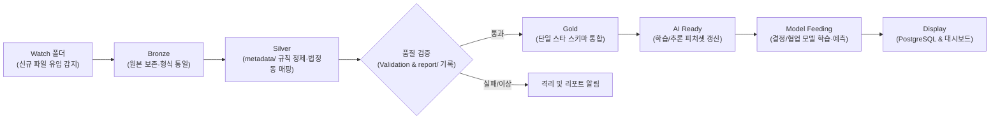

# 프로젝트 인텐트 (Project Intent)

> 본 문서는 **mlo-03-p2-team1** 프로젝트의 핵심 의도(Why & What), 우선순위, 아키텍처 방향성을 정의합니다. 세부 테이블 구조와 구현 명세는 이후 작성할 `SPEC.md`에서 확정합니다.

---

## 1. 핵심 목표 (Core Purpose)

본 프로젝트의 본질은 **서로 다른 채널에서 수집된 더럽고 파편화된 원천 데이터들을 정제·통합하여, 하나의 일관된 스타 스키마(Star Schema)와 AI 학습 파이프라인으로 연결하는 것**입니다.

- **데이터 파이프라인 중심:** `Source → Bronze → Silver → 품질 검증 → Gold (Star Schema) → AI Ready → 모델 학습`으로 이어지는 엔드투엔드 데이터 엔지니어링 및 자동 피딩 구조가 프로젝트의 핵심입니다.
- **디스플레이로서의 대시보드:** 프론트엔드 3D 대시보드(`frontend/`)는 파이프라인과 모델이 만들어낸 최종 산출물을 시각적으로 소비하는 **디스플레이(Display) 계층**입니다. 파이프라인과 스키마를 먼저 확립하고, 대시보드는 데이터 구조에 맞춰 단계적으로 업데이트합니다.

---

## 2. 공간 범위 및 분석 단위: 왜 '서울 · 법정동'인가?

- **서울 우선 시작 (Seoul First):**
  - 다채널 데이터의 결합 완결성과 검증 신뢰도를 확보하기 위해 **서울특별시**를 1차 범위로 시작합니다.
  - 단, 파이프라인 코드는 특정 지역에 하드코딩하지 않고 지역·채널 파라미터를 통해 확장 가능한 구조로 설계합니다.
- **법정동 단위 선정 (Diversity over Gu-level Average):**
  - 서울을 자치구 단위로 묶으면 단 **25개 구**로 축소되어, 같은 구 안에서도 크게 갈리는 상권·주거·인프라의 미시적 특성이 평균에 묻힙니다.
  - 지역 간 **다양성(Diversity)**과 입지 특성 차이를 충분히 보여주고 학습 모델에 풍부한 샘플을 제공하기 위해 **법정동(Legal Dong)**을 기본 공간 단위로 채택합니다.

---

## 3. 데이터 엔지니어링의 핵심 증명 포인트

### ① 다채널 이기종 데이터의 단일 스타 스키마(Star Schema) 통합
- **원천 채널:** **아파트 매매 실거래가**를 중심으로, 전월세·상권·의료 인허가·외부 현황 자료 등 출처와 형태가 서로 다른 그 외 다채널 자료를 결합합니다.
- **해결 과제:** 채널마다 다른 인코딩, 주소/행정코드 체계, 시간 단위(거래일 vs 인허가·폐업 이력 vs 시점 스냅샷), 결측 및 구조적 오염(중복, 재등록, 업태 불일치 등)을 정제하여 **하나의 Gold 스타 스키마**로 합치는 과정을 증명합니다.
- *(스타 스키마의 세부 Fact / Dimension 테이블 구조는 `SPEC.md` 단계에서 결정합니다.)*

### ② 메타데이터 기반 정제와 검증 리포트 분리
- **기준(`metadata/`):** 정제 규칙, 표준 코드, 품질 검사 기준은 파이프라인 코드에 하드코딩하지 않고 `metadata/`의 CSV로 관리합니다.
- **증명(`report/`):** 얼마나 오염된 데이터가 어떤 규칙에 의해 정제·검증되었는지를 실행마다 `report/`에 정량적 리포트로 남깁니다.

---

## 4. AI Ready & 학습 모델 의도

- **예측 타깃 (Target):** 서울 법정동 단위의 **아파트 매매가**
- **모델 방향 (Decision / Collaborative Model):**
  - Gold 스타 스키마로부터 다차원 입지·시계열 피처를 추출해 **AI Ready 데이터셋**을 구축합니다.
  - 이를 바탕으로 **결정 모델(Decision Model)** 혹은 **협업 모델(Collaborative Model)**을 학습하여, 개별 지역의 시계열 추세뿐만 아니라 지역(법정동) 간·주변 인프라 특성 간의 상호작용을 반영한 아파트 매매가 예측을 수행합니다.

---

## 5. 주기적 데이터 자동 피딩 (Watch-Folder Architecture)

일회성 정제 스크립트에 그치지 않고, 주기적으로 추가되는 데이터가 자동으로 파이프라인과 모델에 공급되는 **Watch 폴더 기반 자동 피딩 구조**를 지향합니다.

1. **파일 유입 감지 (Watch Folder):** 지정된 인입 폴더에 새로운 원천 파일(신규 기간 실거래가, 추가 채널 자료 등)이 들어오면 워처(Watcher)가 이를 자동 감지합니다.
2. **자동 정제 및 품질 게이트:** `Bronze` 적재 후 `metadata/` 규칙에 따라 `Silver` 정제와 품질 검증을 수행하고, 결과를 `report/`에 자동 기록합니다.
3. **스타 스키마 및 모델 피딩:** 검증을 통과한 데이터는 `Gold` 스타 스키마와 `AI Ready` 데이터셋에 증분/갱신 반영되어, 결정·협업 모델의 재학습 또는 최신 매매가 예측 추론으로 자동 피딩됩니다.

---

## 6. 단계별 우선순위 원칙

1. **1순위:** 다채널 원천 데이터 정제(`Bronze → Silver`) 및 품질 검증(`metadata/ → report/`) 파이프라인 확립 (서울 법정동 기준)
2. **2순위:** 다채널 정보를 하나로 합치는 `Gold` 스타 스키마 구축 및 PostgreSQL 적재
3. **3순위:** Watch 폴더 기반 자동 피딩 + `AI Ready` 변환 및 아파트 매매가 예측 모델(결정/협업 모델) 연동
4. **4순위:** 대시보드(`frontend/` + `backend/`)를 서울 법정동 및 파이프라인 산출물 기준에 맞게 업데이트
