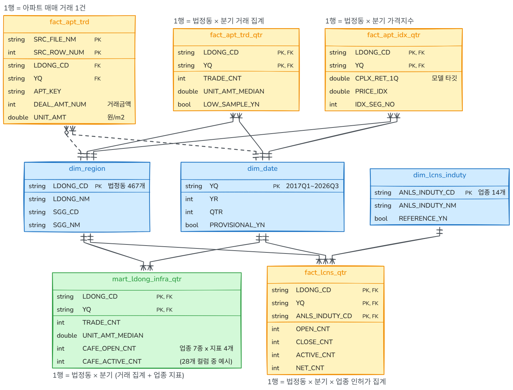
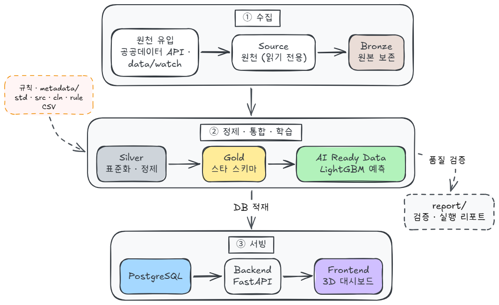
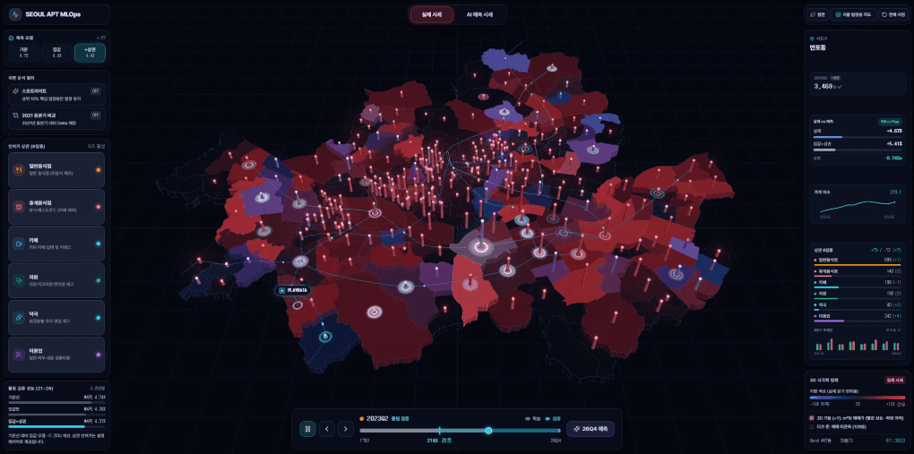
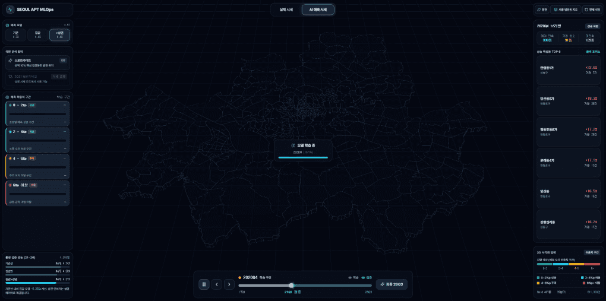

# 서울 부동산 실거래가 × 생활 인프라 AI Ready Data (a.k.a 임장 crew)

**서울 아파트 실거래가와 생활 인프라 공공데이터를 AI Ready Data로 만드는 데이터 엔지니어링 프로젝트입니다.**

## 1. 팀 소개

| 박완규 | 이세훈 | 정상효 | 조경호 |
| :---: | :---: | :---: | :---: |
| [@domomo](https://github.com/domomo) | [@hun117](https://github.com/hun117) | [@nomorehuman90](https://github.com/nomorehuman90) | [@naelonambul](https://github.com/naelonambul) |

---

## 2. 프로젝트 개요

서로 다른 기관에서 따로 관리하는 아파트 매매가와 생활 인프라(음식점·카페·의원·약국·미용업) 원천 데이터 11종을 Source → Bronze → Silver → Gold → AI Ready 단계로 정제·통합해, 분석과 학습에 바로 쓸 수 있게 만드는 프로젝트입니다. 출처마다 제각각인 데이터는 **서울 법정동 × 분기**라는 공통 단위로 맞춰 결합합니다. 데이터의 양보다 **얼마나 더러운 데이터를 얼마나 깔끔하게 만드는지**에 집중합니다. 모든 처리는 기준(`metadata/`)에 따라 수행하고, 실행 결과는 `report/`에 남기는 것을 원칙으로 합니다.

### 수집 데이터

| 구분 | 데이터셋 | 제공기관 | 수집 방식 | 규모 (행 수) |
| --- | --- | --- | --- | ---: |
| 실거래 | 아파트 매매 (`apt_trade`) | 국토교통부 | Open API (XML) | 4,265,480 |
| 실거래 | 아파트 전월세 (`apt_rent`) | 국토교통부 | Open API (XML) | 8,001,132 |
| 인허가 | 일반음식점 (`food_general`) | 서울 열린데이터광장 | Open API | 540,008 |
| 인허가 | 휴게음식점 (`food_rest`) | 〃 | Open API | 148,778 |
| 인허가 | 의원 (`clinic`) | 〃 | Open API | 37,791 |
| 인허가 | 약국 (`pharmacy`) | 〃 | Open API | 22,500 |
| 인허가 | 미용업 (`beauty`) | 〃 | Open API | 100,349 |
| 인허가 보조 | 일반음식점 CSV (`food_general_file`) | 〃 | 파일 (CSV, cp949) | 540,008 |
| 대조용 스냅샷 | 상가(상권)정보 (`store_info`) | 소상공인시장진흥공단 | 파일 (ZIP·CSV) | 2,753,778 (16개 파일) |
| 대조용 스냅샷 | 병의원·약국 현황 (`hira_inst`) | 건강보험심사평가원 | 파일 (ZIP·XLSX) | 915,009 (12개 파일) |
| 코드 | 법정동코드 (`ldong_code`) | 행정안전부 | 파일 (TXT) | 53,403 |
| **합계** | **11종** | | | **17,378,236** |

- 11종 중 8종을 분석에 사용하고, 대조용 스냅샷 2종(2026-09 기준)은 검증·보완에 씁니다. 전월세는 추후 확장 가능성을 고려해 정제까지 마치고 보존합니다.
- 인허가 데이터는 '현재 스냅샷'이지만 폐업 업소까지 남아 있어, 인허가일·폐업일로 **과거 분기의 영업 업소 수를 재구성**합니다.

### AS-IS: 원천 데이터의 문제

원천 데이터는 출처마다 형식과 기준이 달라, 그대로 합치면 결합이 안 되거나 집계가 왜곡됩니다. 분석과 학습에 쓰려면 아래 문제를 먼저 처리해야 합니다.

| 문제 | 예시 | 그대로 쓰면 |
| --- | --- | --- |
| 채널마다 다른 형식 | 인코딩, 행정코드, 시간 단위 | 결합 불가 |
| 폐업일자 없음 | 약국 4,795건, 의원 전출 812건 | 약국 약 4,800곳 부풂 |
| 중복 | 휴게음식점 323건, 매매 12,798행 | 이중 집계 |
| 법정동 정보 부족 | 코드 없이 주소만 있음 | 동 단위 집계 불가 |
| 업종 기준 불일치 | 카페가 여러 업종에 섞임 | 업종 지표 왜곡 |
| 이상값·자리표시 값 | 1950년 이전 인허가일, `02-0000-0000` | 개업 수 왜곡 |

전체 오염 목록과 기대 건수는 오염 정답지 [`metadata/known_issues.csv`](metadata/known_issues.csv)에 있습니다.

### 목표: AI가 바로 쓸 수 있는 데이터

- **형식 통일:** 채널마다 다른 형식을 행 손실 없이 하나의 표준 이름·타입·단위로 통일한다.
- **검증 가능한 정제:** 오염을 정제 전에 정답지로 먼저 정의하고, 정제 결과를 정답지와 대조해 검증한다.
- **쓰임에 맞는 구조:** 분석·학습·서비스에서 바로 쓸 수 있도록 법정동 × 분기 기준의 Gold 스타 스키마로 제공한다.
- **시점 누수 없는 학습 데이터:** 학습에 미래 정보가 섞이지 않는 AI Ready 피처셋을 만든다.

각 목표를 실제로 달성했는지는 수행결과에서 숫자로 보여 줍니다.

---

## 3. 기술 스택

| 영역 | 기술 |
| --- | --- |
| 데이터 파이프라인 |     |
| 모델 |  |
| DB · Backend |   |
| Frontend |       |

---

## 4. WBS

2026-11-23(월) 발표 기준 일정입니다. 세부 체크리스트는 [`plan.md`](plan.md)에 있습니다.

| 일정 | 작업 항목 | 담당 | 상태 |
| --- | --- | --- | --- |
| ~11-19 | 원천 11종 수집, Bronze 적재, Silver 표준화(표준 사전) | 정상효 | 완료 |
| 11-20(금) | Silver 정제 규칙·오염 정답지, 인허가 5종 정제·검증 | 이세훈 | 완료 |
| 11-20(금) | 실거래 매매·전월세, 상가정보, 심평원, 법정동코드 정제 | 정상효 | 완료 |
| 11-20(금) | Gold 요구사항·스타 스키마 설계 | 박완규 · 공동 | 완료 |
| 11-20(금) | Backend, 대시보드 계획 및 프로토타입 구현 | 조경호 | 완료 |
| 11-21(토) | Gold 구현·검증, 같은 단지 가격 지수, PostgreSQL 적재 | 박완규 | 완료 |
| 11-21(토) | AI Ready 피처셋·롤링 검증·시점 누수 검사, 업종 규칙 보완 | 이세훈 | 완료 |
| 11-22(일) | 3D 대시보드 실데이터 연동, Docker를 활용한 E2E 자동 피딩 테스트 | 조경호 | 완료 |
| 11-22(일) | 재현 실행, 발표 자료·데모 시나리오·1차 리허설 | 공동 | 완료 |
| 11-23(월) | 대시보드 배포 점검, README·문서 정리, 최종 리허설·발표 | 공동 | 진행 중 |

---

## 5. 요구사항 명세서

각 단계가 만족해야 할 요구사항과 검증 결과입니다.

| ID | 단계 | 요구사항 | 검증 | 결과 |
| --- | --- | --- | --- | --- |
| B-01 | Bronze | 원천 11종을 값 그대로 Parquet로 저장하고, 행 수가 원천과 같아야 한다. | `01_bronze__manifest.csv` | ✅ 37/37 파일 일치 |
| B-02 | Bronze | 모든 행에 원천 파일 경로와 행 번호(`_source_file`, `_source_row`)를 남겨야 한다. | Bronze Parquet 컬럼 | ✅ 추적 컬럼 확인 |
| B-03 | Bronze | 원천은 읽기 전용(SHA-256 불변)이고, 같은 입력으로 재실행하면 출력이 같아야 한다. | `data/bronze/README.md` | ✅ 원천 불변, 재실행 `unchanged` |
| S-01 | 표준화 | 원천 컬럼을 표준 사전의 이름·타입으로 바꾸고 변환 규칙을 적용해야 한다. | `check_std_rules.py` | ✅ 매핑 419개, 규칙 19/19 |
| S-02 | 표준화 | 날짜·금액을 정의된 타입·단위로 바꾸고, 변환할 수 없는 값은 NULL로 두고 `STD_ERR_TXT`에 기록해야 한다. | `02_silver__change_log.csv` | ✅ 오류 기록 확인 |
| S-03 | 표준화 | 행을 삭제하지 않고 Bronze 파일을 그대로 보존해야 한다. | `02_silver__manifest.csv` | ✅ 37/37 파일, 17,378,236행 |
| S-04 | 정제 | 기준(`cln_*.csv`)에 따라 영업 상태·분석용 개업/폐업일·분석 업종·법정동을 정하고 근거를 기록해야 한다. | `check_cln_rules.py` | ✅ 규칙 47/47 |
| S-05 | 정제 | 휴게음식점 중복 관리번호는 1행만 남기고, 매매의 동일 조건 거래·계약 해제는 플래그로 표시해야 한다. | `03_silver__manifest.csv` | ✅ 323행 제거, 매매는 플래그 |
| S-06 | 품질 검증 | 정제 산출물이 완료 조건을 충족하고, 알려진 오염의 기대 건수와 실제 탐지 건수가 일치해야 한다. | `check_cln_numbers.py` | ✅ 산출물 10/10, 이슈 39/39 |
| G-01 | Gold | 법정동·분기·업종 차원을 만들고 팩트·마트의 키를 연결해야 한다. | `check_gold_tables.py` | ✅ 8개 테이블 (467동 · 39분기 · 14업종) |
| G-02 | Gold | 유효 매매 1건을 1행으로 보존하고, 동·분기별 거래 수와 ㎡당 매매가 중앙값을 집계해야 한다. 표본 5건 미만은 `LOW_SAMPLE_YN`으로 표시한다. | `check_gold_tables.py`<br>`check_gold_numbers.py` | ✅ 611,300행 · 18,213행, 이슈 4/4 |
| G-03 | Gold | 동·분기·업종별 개업·폐업·기말 영업·순증을 집계하고, 거래 지표와 결합한 마트를 만들어야 한다. | `check_gold_tables.py` | ✅ 254,982행 · 마트 18,213행 |
| G-04 | Gold | 두 분기에 모두 거래된 같은 단지 기준으로 가격 변화율과 가격 지수를 산출해야 한다. | `check_gold_tables.py` | ✅ 18,213행 |
| AR-01 | AI Ready | 법정동 × 기준 분기 1행으로 만들고, 피처는 기준 분기까지의 값으로만 계산해야 한다. | `check_ai_ready.py` AR1·AR3 | ✅ 피처 48개, 시점 누수 없음 |
| AR-02 | AI Ready | 다음 분기 같은 단지 가격 로그 변화율을 타깃으로 하고, 마지막 분기는 예측용(타깃 NULL)으로 둔다. | `check_ai_ready.py` AR1·AR2 | ✅ 학습·평가 7,300행, 예측 221행 |
| AR-03 | AI Ready | 기준선·집값·집값+상권 모델을 롤링 검증으로 비교하고, 예측과 평가 결과를 저장해야 한다. | `check_ai_ready.py` AR4~AR6 | ✅ 예측 12,837행, 검사 25/25 |
| DB-01 | DB 적재 | Gold·AI Ready를 PostgreSQL에 적재하고, 로컬 파일과 행 수·값이 같아야 한다. | `postgresql_load_verification.csv` | ✅ Gold 8/8, AI Ready 2/2 일치 |

---

## 6. Gold 데이터 (스타 스키마)

Gold는 **법정동 × 분기 단위로 아파트 매매가를 예측하는 것**에서 출발해 설계했습니다. 실거래가가 법정동 기준이라 주소 변환 없이 결합되고, 월 단위로 나누면 동별 거래·개업 수가 대부분 0이 되기 때문에 분기를 택했습니다. 팩트는 거래, 가격 변화, 인허가처럼 측정 단위별로 나누고, 모두 법정동과 분기로 연결해 쓰임마다 필요한 테이블을 골라 쓸 수 있게 했습니다.

| 쓰임 | 필요한 것 | 쓰는 테이블 |
| --- | --- | --- |
| 예측 모델 | 타깃인 같은 단지 가격 변화율과 가격·거래 구성·상권 피처 | `fact_apt_idx_qtr`, `fact_apt_trd_qtr`, `fact_apt_trd`, `mart_ldong_infra_qtr`<br>→ AI Ready `feature_set` (모델 전용 테이블) |
| 대시보드 | 동·분기별 매매가와 업종 지표를 한 행에 모은 값, 표본이 적은 값 표시 | `mart_ldong_infra_qtr` |
| 검증·재집계 | 집계 전 매매 거래 1건 단위 원본과 업종별 인허가 집계 | `fact_apt_trd`, `fact_lcns_qtr` |



| 테이블 | 한 행의 의미 | 키 | 행 수 |
| --- | --- | --- | ---: |
| `dim_region` | 서울 법정동 하나 (상위 자치구 포함) | `LDONG_CD` | 467 |
| `dim_date` | 분기 하나 (시작·종료일) | `YQ` | 39 |
| `dim_lcns_induty` | 분석 업종 하나 (참고 지표 여부 포함) | `ANLS_INDUTY_CD` | 14 |
| `fact_apt_trd` | 유효한 아파트 매매 거래 1건 | 원천 파일명 × 행 번호 | 611,300 |
| `fact_apt_trd_qtr` | 법정동 × 분기의 거래 수, ㎡당 매매가 중앙값 | `LDONG_CD` × `YQ` | 18,213 |
| `fact_apt_idx_qtr` | 법정동 × 분기의 같은 단지 기준 가격 변화율과 가격 지수 | `LDONG_CD` × `YQ` | 18,213 |
| `fact_lcns_qtr` | 법정동 × 분기 × 업종의 개업·폐업·분기 말 영업·순증 수 | `LDONG_CD` × `YQ` × `ANLS_INDUTY_CD` | 254,982 |
| `mart_ldong_infra_qtr` | 법정동 × 분기 1행: 매매가 + 인프라 지표 + 희소 표본 플래그 | `LDONG_CD` × `YQ` | 18,213 |

- **인허가:** 분기 말 영업 수 = 분석용 개업일 ≤ 분기 말 < 분석용 폐업일.
- **매매:** 계약 해제 거래는 빼고, 동일 조건 중복 거래는 묶음마다 1건만 남겨 집계합니다.
- 가격 표본이 5건 미만인 셀(9,593개)은 `LOW_SAMPLE_YN`으로 표시하고 값은 보존합니다.

자세한 집계 과정: [`report/gold/04_gold__work_summary.md`](report/gold/04_gold__work_summary.md)

---

## 7. 처리 구조 (파이프라인)

<!-- TODO(임시 보관): AS-IS에서 뺀 "처리" 열. 프로시저 Silver 정제 부분에 "문제 → 처리" 표로 옮길 것.
| 문제 | 처리 |
| --- | --- |
| 채널마다 다른 형식 | 표준 사전으로 이름·타입·단위 통일 |
| 폐업일자 없음 | 최종수정일자를 대용 폐업일로 |
| 중복 | 관리번호 중복은 최신 1행, 동일 조건 거래는 첫 행만 |
| 법정동 정보 부족 | 원본코드 → 지번 → 도로명 순으로 부여 |
| 업종 기준 불일치 | 업태 + 상호 키워드로 카페 분류 |
| 이상값·자리표시 값 | 값은 유지하고 플래그·이슈 목록으로 표시 |
-->



실행 파일은 `pipeline/` 아래 단계별 폴더에 있고, 적재 스크립트만 `pipeline_container/`에 있습니다. 데이터 파일은 git에 올리지 않으며, 원천 목록·크기·SHA-256은 `data/source/SOURCE_README.md`, `_source_manifest.csv`에 기록합니다.

| 단계 | 한 일 | 검증 | 실행 파일 | 기준 (`metadata/`) |
| --- | --- | --- | --- | --- |
| 00 Source | API 응답 원문 저장, 파일 수집 | 원천 읽기 전용, SHA-256 기록 | `00_collect.py` | `src_*.csv` |
| 01 Bronze | 원천을 값 그대로 parquet로, 추적 컬럼 추가 | 행 수 = 원천, 원천 불변 | `01_bronze.py` | `ds_dataset.csv` |
| 02 Silver 표준화 | 표준 사전으로 컬럼명·타입·단위 통일 | 행 수 = Bronze (37/37 파일) | `02_normalize.py` | `std_*.csv` |
| 03 Silver 정제 | 중복·영업 상태·대용 폐업일·법정동·분석 업종 판정 | 오염 정답지 39개 항목 차이 0 (오염 34 + 0건 확인 3 + 기준값 2)<br>행 수 = 02 − 중복 제거 (10/10 데이터셋) | `03_clean.py` | `cln_*.csv`<br>`known_issues.csv` |
| 04 Gold | 법정동 × 분기 집계, 같은 단지 가격 지수, 스타 스키마 | 정답지 중 매매 4개 항목 재확인 차이 0<br>차원 연결률 100%<br>구 합계 = 동 합계 + 법정동 실패 | `04_gold.py` | `rule_gold_*.csv` |
| 05 AI Ready | 피처셋 생성, 롤링 검증, 다음 분기 예측 | AR1~AR6 전부 PASS (시점 누수 검사 포함) | `05_feature_set.py`<br>`05_train.py` | `rule_ai_ready_*.csv` |
| 적재 | Gold·AI Ready를 PostgreSQL에 적재 | 적재 테이블 행 수·값 PASS | `load_postgres.py` | `db/01_schema.sql` |

**표준 사전**: 같은 "인허가일자"도 API에서는 `APVPERMYMD`, CSV에서는 `인허가일자`로 옵니다. 이런 원천 컬럼 419개를 사전 하나로 `LCNS_DTM` 같은 표준 이름·타입·단위로 통일했습니다. 사전은 표준 단어 199개와 접미사 9개(`_DTM` 날짜, `_CD` 코드, `_NM` 이름 등)로 이름을 짓고, 변환 규칙 17개(공백 제거, 만원 → 원 등)로 값을 맞춥니다.

**구현 원칙**

- 정제 규칙은 코드에 하드코딩하지 않고 `metadata/` CSV에서 읽습니다. 실행 결과는 `report/`에 남깁니다.
- 원본 컬럼은 덮어쓰지 않습니다. 판단으로 만든 값은 분석용 컬럼과 출처 컬럼으로 붙입니다.
- 행을 지우는 것은 관리번호 중복뿐입니다. 무엇을 집계에서 뺄지는 Gold가 플래그를 보고 정합니다.
- 같은 입력으로 다시 실행하면 같은 파일이 나옵니다(`status=unchanged`).

---

## 8. AI Ready 데이터

### 8.1 학습용 피처셋 (`feature_set`)

Gold 테이블을 법정동 × 분기 한 행으로 모아, 모델이 바로 학습할 수 있는 피처셋을 만들었습니다.

| 항목 | 내용 |
| --- | --- |
| 한 행 | 법정동 × 분기 t |
| 타깃 | 다음 분기(t+1) 같은 단지 기준 ㎡당 매매가 변화율 |
| 피처 | 48개: 가격 흐름(`PRICE`) 16개, 상권(`LCNS`) 32개. 분기 t까지의 값만 사용 |
| 규모 | 269개 법정동, 학습·평가 7,300행, 다음 분기 예측 221행 |
| 구분 | `labeled`(학습·평가) / `predict`(마지막 분기, 다음 분기 예측용) |

피처 이름·묶음·설명은 코드가 아니라 [`metadata/rule_ai_ready_feature.csv`](metadata/rule_ai_ready_feature.csv)에 정의했습니다.

### 8.2 왜 변화율인가

처음에는 법정동의 분기 매매가 수준을 예측하려 했지만, 두 가지 문제가 있었습니다.

- 동 매매가 중앙값은 **그 분기에 어떤 단지가 팔렸는지**에 따라 크게 출렁입니다. 비싼 단지가 몇 건 더 팔리면 실제 가격 변화가 없어도 값이 오릅니다.
- 가격 수준은 대부분 위치(구·동)로 설명되어, 모델이 맞혀도 새로 알려 주는 정보가 적습니다.

그래서 예측 대상을 **다음 분기 같은 단지 기준 ㎡당 매매가 변화율**로 바꿨습니다. 두 분기에 모두 거래된 같은 단지끼리만 비교하므로, 어떤 단지가 많이 팔렸는지에 따라 값이 출렁이는 문제가 줄어듭니다.

모델은 변화율을 예측하지만, 처음 목표였던 매매가도 놓치지 않도록 예측 변화율을 기준 분기(예측 시점)의 동 ㎡당 매매가 중앙값에 적용한 예측 매매가를 계산해 대시보드에 참고용으로 함께 보여 줍니다.

### 8.3 검증

AI Ready 데이터에서 가장 경계해야 할 문제는 학습에 미래 정보가 섞이는 **시점 누수**입니다. 구현 코드를 쓰지 않고 Gold에서 따로 계산해 대조하는 검사(`pipeline/validation/check_ai_ready.py`)를 두었고, 모든 항목이 통과했습니다.

| 검사 | 내용 | 결과 |
| --- | --- | --- |
| 시점 누수 | Gold를 분기 t까지 잘라 다시 만든 피처가 원래 피처와 같은지 (4개 시점) | PASS |
| 타깃 재계산 | 거래 원본에서 직접 계산한 변화율 = 타깃 | 7,300행 PASS |
| 키·연결 | 키 중복 0, Gold 차원 연결, 타깃 분기 = 다음 분기 | PASS |

전체 검사 결과: [`report/ai_ready/05_ai_ready__check.csv`](report/ai_ready/05_ai_ready__check.csv)

### 8.4 이 데이터로 돌려 본 예측

테스트 연도(2021~2026)마다 그 이전 데이터로만 학습하는 **롤링 검증**으로 평가했습니다.

| 모델 | 오차 (MAPE) | 방향 정확도 |
| --- | ---: | ---: |
| 기준선 ("다음 분기에도 그대로") | 4.74% | — |
| 집값 흐름 (LightGBM) | 4.38% | 72.3% |
| 집값 흐름 + 상권(인허가 증감) | 4.37% | 72.4% |

- **집값 흐름 모델은 기준선보다 오차를 0.36%p 줄였습니다** (95% 신뢰구간 [-0.47, -0.25]%p, 6개 연도 중 4개 연도 개선).
- **상권 피처를 더해도 정확도는 사실상 같았습니다** (차이 -0.002%p, 신뢰구간이 0을 포함).
- 금리 인상으로 시장이 꺾인 2022년에는 기준선보다 크게 틀렸습니다(방향 정확도 33%).

전체 결과: [`report/ai_ready/05_ai_ready__summary.md`](report/ai_ready/05_ai_ready__summary.md)

---

## 9. 대시보드

대시보드는 앞서 정제·통합한 **Gold와 AI Ready 데이터를 화면에 띄웁니다.** PostgreSQL에 적재한 테이블을 FastAPI 백엔드가 읽어 프론트엔드(React + React Three Fiber)에 전달하고, 지도와 상세 패널의 수치는 아래 표의 테이블에서 옵니다.

**실거래 시세**: 법정동별 분기 매매가 변화와 업종별 인프라 지표



**AI 예측 시세**: 다음 분기 예측 변화율과 예측 매매가



| 화면 | 보여 주는 것 | 데이터 |
| --- | --- | --- |
| 3D 지도 (실거래 시세) | 법정동별 실제 가격 변화율(색), ㎡당 매매가(기둥 높이), 선택한 업종이 많은 동(파동) | `gold.mart_ldong_infra_qtr`, `gold.fact_apt_idx_qtr` |
| 3D 지도 (AI 예측 시세) | 지난 분기: 예측이 실제와 얼마나 빗나갔는지 4단계 색으로<br>다음 분기: 예측한 가격 변화율을 색으로 | `ai_ready.prediction` |
| 타임라인 | 2017Q1~2026Q3 분기 이동, 학습·검증 구간, 다음 분기 예측 | `ai_ready.prediction` |
| 지역 상세 (법정동 클릭 시 오른쪽 패널) | 동 ㎡당 매매가, 실제와 예측 변화율, 가격 지수 추이, 업종별 증감 | `gold.mart_ldong_infra_qtr`, `gold.fact_apt_idx_qtr`, `ai_ready.prediction` |
| 모델 비교 | 기준선·집값·집값+상권 모델의 오차(MAPE), 예측 오차 구간 | `ai_ready.prediction`, 롤링 검증 결과 |

- 상단 탭에서 실거래 시세와 AI 예측 시세를 전환하고, 하단 타임라인으로 분기를 옮깁니다.
- 법정동을 클릭하면 그 동의 매매가, 실제와 예측 변화율, 업종별 증감을 볼 수 있습니다.

---

## 10. 저장소 구성과 산출물

```text
mlo-03-p2-team1/
├── data/          단계별 데이터 (source, bronze, silver, gold, ai_ready) — git 제외
├── pipeline/      단계별 변환 코드 + validation + common
├── pipeline_container/  자동 실행·DB 적재 스크립트 (테스트 환경)
├── metadata/      기준 CSV: 표준 사전, 정제 규칙, Gold·AI Ready 규칙, 오염 정답지
├── report/        실행 결과: manifest, 변경 로그, 정답지 대조, 적재 검증
├── samples/       비식별 샘플 원천 (전체 흐름 재현용)
├── db/            PostgreSQL 스키마
├── docs/          설계 문서(manual), ERD, 실행 증거(evidence)
├── backend/       FastAPI API 서버
├── frontend/      React 3D 대시보드
├── INTENT.md      기획 의도와 우선순위
├── SPEC.md        기술 스택·인프라 명세
└── plan.md        일정과 단계별 체크리스트
```

| 산출물 | 위치 |
| --- | --- |
| 원천 목록·해시 | `data/source/SOURCE_README.md`, `_source_manifest.csv` |
| 표준 사전 | `metadata/std_*.csv` |
| 정제 기준·오염 정답지 | `metadata/cln_*.csv`, `metadata/known_issues.csv` |
| Gold·AI Ready 규칙 | `metadata/rule_gold_*.csv`, `metadata/rule_ai_ready_*.csv` |
| 단계별 실행 기록 | `report/silver/`, `report/gold/`, `report/ai_ready/` |
| PostgreSQL 적재 검증 | `report/postgresql_load_verification.csv` |
| 데이터 모델 ERD | `docs/erd/gold_star_schema.png` |

---

## 11. 한계와 향후 과제

| 한계 | 향후 과제 |
| --- | --- |
| **과거 분기 외부 검증 불가**<br>대조용 스냅샷(심평원·상가정보)이 2026년 9월 한 시점뿐이라, 중간에 삭제된 인허가 레코드가 있다면 과거 영업 수가 적게 잡힐 수 있습니다. | 의원·약국은 심평원 연말 기준 요양기관 개설 현황으로 연도별 대조, 이후 분기는 스냅샷을 모아 검증 |
| **정제 규칙의 오차**<br>이전·교체는 확실할 때만 연결해 일부 이중 집계가 남고, 카페는 업태와 상호 키워드로 분류해 일부 오분류가 있을 수 있습니다. | 상가정보 카페 위치와의 대조율로 규칙 보정 |
| **최근 분기 폐업 누락**<br>폐업 신고가 늦게 들어와 최근 분기의 폐업이 덜 잡힐 수 있습니다. | 잠정치 표시(`PROVISIONAL_YN`) 기준 마련 |
| **개업·폐업에 이전·재등록 포함**<br>Gold는 전체 기준으로 집계해, 가게가 자리를 옮기기만 해도 폐업 1건과 개업 1건으로 잡힙니다. | Silver의 이전·교체 연결을 활용해 이를 뺀 개업·폐업 지표를 Gold에 추가 |
| **거래가 적은 동의 가격 불안정**<br>유효 매매가 없는 동이 129개, 가격 표본 5건 미만 셀이 9,593개입니다. | 인접 동이나 구 단위로 보완하는 지표 검토 |
| **일부 집계가 AI Ready에 있음**<br>거래 구성(건물 나이·면적)과 구 단위 가격 집계를 AI Ready에서 계산해, 다른 쓰임에서 재사용할 수 없습니다. | Gold 분기 팩트로 옮기기 |
