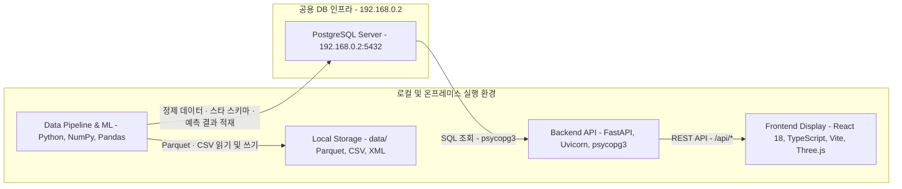

# 기술 스택 및 인프라 명세 (SPEC.md)

> 본 문서는 **mlo-03-p2-team1** 프로젝트의 **기술 스택(Tech Stack)** 과 **인프라(Infrastructure) 환경**을 정의합니다.

---

## 1. 전체 인프라 아키텍처

본 프로젝트는 **로컬/온프레미스 직접 실행 환경(Python 가상환경 + Vite 서버)** 과 **내부망 공용 PostgreSQL 데이터베이스 서버(`192.168.0.2`)** 를 연결하는 구조로 운영합니다.



---

## 2. 영역별 기술 스택

### 2.1 데이터 파이프라인 및 학습 (Data Pipeline & ML)

| 구분 | 기술 / 라이브러리 | 용도 및 명세 |
|---|---|---|
| **언어** | Python 3.x | 데이터 수집, 정제, 검증, 스타 스키마 생성 및 모델 학습 전 과정 |
| **수치·배열 연산** | `NumPy` | 수치 연산, 벡터/행렬 처리, 피처 엔지니어링 및 모델 연산 |
| **데이터 처리** | `Pandas` | 다채널 원천 데이터(CSV, XML, TXT, XLSX) 파싱, 정제, 집계 및 조인 |
| **파일 스토리지 포맷** | Apache Parquet (`snappy`) | 계층별(`bronze`, `silver`, `gold`, `ai_ready`) 로컬 중간 산출물 저장 및 재현성 보장 |
| **무결성 · 추적** | `hashlib` (SHA-256), Read-only 속성 | 원천(`Source`) 및 단계별 산출물 위변조 검증, 매니페스트(`manifest.csv`) 관리 |

### 2.2 데이터베이스 인프라 (Database)

| 항목 | 명세 | 비고 |
|---|---|---|
| **DBMS** | PostgreSQL | 정제 완료 데이터(Gold 스타 스키마, AI Ready, 예측 결과) 적재 및 서빙 |
| **호스트 주소** | `192.168.0.2` (내부망) | 외부/VPN 접속 시 `.env`의 `DBHOST`로 오버라이드 가능 (예: `100.100.100.60`) |
| **포트** | `5432` | `DBPORT` 환경변수로 제어 |
| **데이터베이스 / 계정** | `DBNAME=web` / `DBID=web` | 비밀번호(`DBPW`)는 `.env`로 주입 (Git 커밋 제외) |
| **보안 연결** | `DBSSLMODE=disable` | 내부망 연결 (`connect_timeout=5` 적용) |

### 2.3 백엔드 서버 (Backend API)

| 구분 | 기술 / 패키지 | 버전 명세 | 용도 |
|---|---|---|---|
| **웹 프레임워크** | `FastAPI` | `>=0.115, <1` | REST API 엔드포인트 제공 (`/api/*`) 및 OpenAPI(`/docs`) 문서 자동화 |
| **ASGI 서버** | `Uvicorn` | `>=0.34, <1` | 비동기/멀티워커 HTTP 애플리케이션 서버 |
| **DB 드라이버** | `psycopg[binary]` (psycopg 3) | `>=3.2, <4` | ORM 없이 PostgreSQL 직접 연결 및 파라미터 바인딩 SQL 실행 |
| **환경변수 관리** | `python-dotenv` | `>=1, <2` | 루트 `.env` 설정 로드 |
| **테스트 도구** | `pytest`, `httpx2` | `pytest>=8,<10`, `httpx2>=2,<3` | 엔드포인트 및 DB 연결 상태(`/api/health`) 단위·통합 테스트 |

### 2.4 프론트엔드 대시보드 (Frontend Display)

| 구분 | 기술 / 패키지 | 버전 명세 | 용도 |
|---|---|---|---|
| **UI 코어** | `React`, `React DOM` | `^18.3.1` | 컴포넌트 기반 UI 및 2D HUD 오버레이 렌더링 |
| **언어 · 빌드** | `TypeScript`, `Vite` | `TS ^5.6.3`, `Vite ^5.4.11` | 정적 타입 검증 및 개발/번들링 서버 (`0.0.0.0:5173` LAN 개방) |
| **3D / WebGL** | `Three.js`, `@react-three/fiber`, `@react-three/drei`, `@react-three/postprocessing` | `three ^0.169.0`, `R3F ^8.17.10` | 3D 지역 폴리곤, 예측 오차 막대, 입지 시설 이펙트 WebGL 렌더링 |
| **지리 데이터 처리** | `d3-geo`, `topojson-client` | `d3-geo ^3.1.1`, `topojson ^3.1.0` | 행정구역 TopoJSON 병합 및 경위도 → 3D 월드 좌표 투영 (`geoMercator`) |
| **상태 관리 · 스타일** | `zustand`, `Tailwind CSS`, `lucide-react` | `zustand ^5.0.1`, `tailwind ^3.4.15` | 3D 캔버스-2D HUD 상태 동기화 및 글래스모피즘 UI 스타일링 |

---

## 3. 스토리지 및 디렉터리 인프라 구조

```text
mlo-03-p2-team1/
├── .env                   # 로컬 환경변수 및 인증키/DB 비밀번호 (Git 추적 제외)
├── .env.example           # 환경변수 템플릿
├── INTENT.md              # 프로젝트 기획 의도 및 방향성
├── SPEC.md                # 기술 스택·인프라 및 시스템 상세 명세 (본 문서)
├── data/                  # 단계별 로컬 데이터 스토리지 (실제 데이터는 .gitignore 제외)
│   ├── source/            # 읽기 전용 수집 원천 파일(CSV/ZIP/XML)
│   ├── watch/             # Bronze PostgreSQL로 적재할 실거래 CSV 인입
│   ├── processed/         # Bronze PostgreSQL 적재가 끝난 CSV 보관
│   ├── bronze/            # 1차 적재 Parquet (원천 행 수·값 보존 + 추적 컬럼)
│   ├── silver/            # 2차·3차 표준화·정제 Parquet
│   ├── gold/              # 4차 스타 스키마 집계 Parquet
│   └── ai_ready/          # 모델 학습·추론용 최종 피처셋
├── pipeline/              # 단계별 파이프라인 및 검증 실행 코드 (Python · NumPy · Pandas)
│   ├── common/            # 공통 입출력, DB 연결, 해시/매니페스트 유틸리티
│   ├── bronze/            # Source → Bronze 변환
│   ├── silver/            # Bronze → Silver 정제 (metadata/ 규칙 기반)
│   ├── gold/              # Silver → Gold 스타 스키마 구축 및 DB 적재
│   ├── ai_ready/          # Gold → AI Ready 피처 생성 및 모델 피딩
│   └── validation/        # 단계별 데이터 품질 검증
├── metadata/              # 정제·표준·품질 규칙 정의 CSV (std_, src_, ds_, rule_)
├── report/                # 파이프라인 실행 및 품질 검증 결과 리포트
├── backend/               # FastAPI + psycopg3 API 서버
│   ├── app/
│   │   ├── main.py        # FastAPI 앱 엔트리포인트
│   │   ├── db.py          # PostgreSQL 연결 모듈
│   │   └── features/      # 기능별 라우터·쿼리·스키마 (health, dashboard 등)
│   ├── requirements.txt
│   └── requirements-dev.txt
├── frontend/              # React 18 + R3F 3D 시각화 대시보드
└── docs/                  # 분석 제안서, 수집 가이드, 설계 초안 등 참고 문서
```

---

## 4. 환경변수 및 보안 설정 규격 (`.env`)

모든 민감 정보(API 인증키, DB 접속 비밀번호)는 코드에 하드코딩하지 않고 프로젝트 루트의 `.env` 파일을 통해 주입합니다.

```ini
# 1. 외부 공공데이터 수집 API 인증키
DATA_GO_KR_KEY=           # 공공데이터포털 일반 인증키 (Decoding)
DATA_SEOUL_GO_KR_KEY=     # 서울 열린데이터광장 일반 인증키

# 2. PostgreSQL 데이터베이스 연결 정보
DBHOST=192.168.0.2        # 공용 PostgreSQL 서버 IP (내부망: 192.168.0.2 / VPN: 100.100.100.60)
DBPORT=5432
DBNAME=web
DBID=web
DBPW=                     # DB 접속 비밀번호
DBSSLMODE=disable
```

---

## 5. 실행 및 운영 환경 (On-Premise / Local Runtime)

### 5.1 백엔드 서버 실행 및 테스트
```powershell
# 의존성 설치
python -m pip install -r backend/requirements.txt
python -m pip install -r backend/requirements-dev.txt

# 개발 서버 실행 (http://localhost:8000)
python -m uvicorn backend.app.main:app --reload

# 헬스체크 및 단위 테스트 실행
python -m pytest backend
```

### 5.2 프론트엔드 대시보드 실행 및 빌드
```powershell
cd frontend
npm install

# 개발 서버 실행 (로컬: http://localhost:5173 / LAN: http://<호스트IP>:5173)
npm run dev

# 프로덕션 타입 체크 및 번들 빌드
npm run build
```
