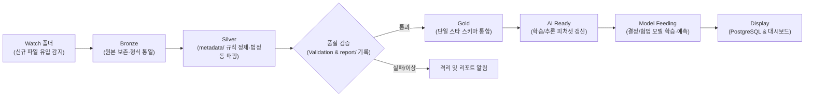

# 04. 파이프라인 구조와 실행

> **이 문서의 출처**
> - `../archive/설계서_초안.md` — 아키텍처 (L24–28), 구현: 원칙·단계와 산출물·파일명 규칙·데이터 사전·프로젝트 구조·실행 순서·검증 결과 (L513–669)
> - `../archive/분석범위_제안.md` — 파이프라인 설계 개요 (L334–344), 실행 가능성과 난이도 (L384–401)
> - `../archive/silver_표준화.md` — 3장 파일 구성 (L36–71)
> - `/INTENT.md` — 3장 ② metadata/report 분리 (L34–36), 5장 Watch 폴더 자동 피딩 (L49–67)
> - `/plan.md` — 단계별 경로와 상태 (L24–86)
>
> 이전 문서: `03_원천데이터_점검과_재구성_검증.md` · 다음 문서: `05_Silver_표준화_02단계.md`

---

## 1. 전체 흐름 (메달리온)

> 출처: `설계서_초안.md` § 아키텍처 (L24–28), § 구현 (L515) / `분석범위_제안.md` § 파이프라인 설계 (L336–344)

```
Source   원천 (API XML 원문, 내려받은 zip·CSV)          → data/source/   (읽기 전용)
  ↓ 00
브론즈   원본 CSV + 실거래가 API 응답을 수집일과 함께 그대로 저장 → data/bronze/
  ↓ 01
실버 02  표준화: 이름·타입·표기 (행 수 = bronze)        → data/silver/
  ↓
실버 03  정제 → 법정동 코드 부여 → 업소 단위 이벤트 테이블 (예정)
  ↓ 04
골드     법정동 × 분기 × 업종 집계 + 실거래가 결합 (예정) → data/gold/
  ↓
AI ready 분석 목적에 맞춘 학습셋 / 대시보드용 테이블
```

- 소스는 단계별로 추가되지만 **Bronze → Silver → Gold 구조는 처음부터 고정**합니다.
- 각 계층은 팀 저장소의 `data/` 아래에 parquet 파일로 쌓고, 실제 적재 DB는 MariaDB와 PostgreSQL 중에서 정합니다(`08_ML_데이터셋과_적재DB.md`).
- 설계를 팀 저장소의 `pipeline/` 아래 단계별 파이썬 스크립트로 구현합니다. 처음에는 개인 PC 폴더(`infra-data-pipeline`)에서 만들었고, 2026-11-19에 01·02 단계를 팀 저장소 규칙(코드는 `pipeline/{단계}`, 기준은 `metadata/` CSV, 실행 결과는 `report/`)에 맞춰 새로 구성했습니다.
- 1차(Bronze)와 2차(Silver 표준화)까지 만들었고(11개 데이터셋: 실거래 2, 상가·병의원약국·법정동 3, 서울 인허가 5, 일반음식점 보조 CSV 1), 3차 정규화와 4차 Gold는 2차 결과를 검토한 뒤 진행합니다.

### 1-1. 목표 구조: Watch 폴더 기반 자동 피딩 (계획)

> 출처: `INTENT.md` § 5 (L49–67)

일회성 정제 스크립트에 그치지 않고, 주기적으로 추가되는 데이터가 자동으로 파이프라인과 모델에 공급되는 **Watch 폴더 기반 자동 피딩 구조**를 지향합니다.



1. **파일 유입 감지 (Watch Folder):** 지정된 인입 폴더에 새로운 원천 파일(신규 기간 실거래가, 추가 채널 자료 등)이 들어오면 워처(Watcher)가 이를 자동 감지합니다.
2. **자동 정제 및 품질 게이트:** `Bronze` 적재 후 `metadata/` 규칙에 따라 `Silver` 정제와 품질 검증을 수행하고, 결과를 `report/`에 자동 기록합니다.
3. **스타 스키마 및 모델 피딩:** 검증을 통과한 데이터는 `Gold` 스타 스키마와 `AI Ready` 데이터셋에 증분/갱신 반영되어, 결정·협업 모델의 재학습 또는 최신 매매가 예측 추론으로 자동 피딩됩니다.

**현재 구현과의 관계 (매뉴얼 정리)**
- 지금 있는 것은 수동 실행 단계(00 → 01 → 02)와, 서울 인허가 월 1회 스냅샷을 Windows 작업 스케줄러로 예약하는 **선택 가이드**뿐입니다(`02_데이터_수집.md` 7장, 아직 등록하지 않음). 워처, 품질 게이트의 "격리", 증분 반영은 아직 없습니다.
- 지금 구조가 자동 피딩의 바탕이 됩니다: 내용이 같으면 기존 파일 유지(`unchanged`), `--dataset` 부분 실행, 실행마다 `report/` 기록, 이번 달 스냅샷이 있으면 건너뛰는 수집기.
- `silver_정제.md` [C5]는 "분석 종료일 < 수집일" 자동 검사를 **월간 자동 피딩을 만들 때 추가**한다고 적고 있습니다.
- `plan.md`에서는 3순위 중 "(선택) Watch 폴더 자동 피딩 — 신규 파일 감지 → 02·03 → gold 재실행"으로 두고, 일정이 밀리면 대시보드 다음으로 먼저 줄일 범위로 정했습니다.


### 1-2. Watch 폴더에서 실거래 CSV를 Bronze DB에 적재 (도입 범위)

별도 구현 PR이 병합되면 FastAPI가 시작할 때 서버의 `data/watch/`를 확인하고, 검사 후 60초마다 다시 확인합니다. 워치 폴더에는 복사가 끝난 UTF-8 실거래 CSV를 넣습니다. 파일 정보와 거래 행을 `public.bronze_file`, `public.apt_trade`에 한 트랜잭션으로 적재한 뒤, CSV를 `data/watch/`와 같은 레벨의 `data/processed/`로 옮깁니다. 파일을 넣는 방법과 실행 조건은 [백엔드 실행 안내](../../backend/README.md#워치-폴더)를 참고합니다.

이번 도입 범위는 실거래 CSV의 Bronze DB 적재까지입니다. Silver와 Gold 자동 실행은 1-1절의 계획에 있습니다. [초기 실행 로그](../evidence/fastapi-watch-20261120-114626-3c0d75cf.txt)는 약 60초 후 파일 감지와 실제 DB 적재·롤백을 확인한 기록입니다. 당시 테스트의 처리 완료 폴더는 임시 워치 폴더 아래에 있었습니다.

---

## 2. 구현 원칙

> 출처: `설계서_초안.md` § 원칙 (L517–526), `INTENT.md` § 3 ② (L34–36)

- **기준은 `metadata/`, 증명은 `report/` (INTENT):** 정제 규칙·표준 코드·품질 검사 기준은 코드에 하드코딩하지 않고 `metadata/` CSV로 관리하고, 얼마나 오염된 데이터가 어떤 규칙으로 정제·검증되었는지를 실행마다 `report/`에 정량적으로 남깁니다. 아래 원칙들은 이것을 구현하는 방법입니다.
- **원천(`data/source`)과 bronze는 읽기만 한다:** 수정·이동·덮어쓰기 금지. 실행 전후 SHA-256을 비교하고, 원천에는 읽기 전용 속성을 건다.
- **각 단계는 앞 단계 파일을 읽어 새 parquet 파일만 만든다.**
- **행 수는 단계 사이에 그대로 둔다:** bronze = 원천, silver = bronze. 행 삭제·중복 제거는 3차에서 한다.
- **다시 실행해도 같은 파일이 나온다:** 입력 정렬, 고정 배치 크기(10만 행), 고정 압축(snappy), 데이터에 실행 시각을 넣지 않음. 내용이 같으면 기존 파일을 그대로 둔다(unchanged).
- **기준은 코드가 아니라 `metadata/` CSV에 둔다:** 원천 읽는 방법은 `ds_dataset.csv`, 표준화 규칙은 `std_*.csv`. 결과에 영향을 주는 실행 옵션(배치 크기·압축)만 각 스크립트 맨 위에 상수로 고정한다.
- **`pipeline/common/`에는 두 단계 이상에서 쓰는 코드만 둔다**(경로·파일 안전 장치·결과 기록·표준화 사전). 원천 읽기처럼 한 단계에서만 쓰는 코드는 그 단계 폴더에 둔다.
- **실행 결과는 `report/{단계}/`의 manifest CSV와 `data/{단계}/README.md`로 자동으로 남긴다.** 일부 데이터셋만 실행(`--dataset`)해도 다른 데이터셋 행은 이전 결과를 유지한다.
- 원천 폴더의 메타 파일(`_source_manifest.csv`, `_collect_log.csv`, `_seoul_collect_log.csv`, `README.md`, `SOURCE_README.md`, `logs/`)은 수집기가 계속 갱신하므로 비교·잠금 대상에서 뺀다(`pipeline/common/source_reader.py`).

---

## 3. 단계와 산출물

> 출처: `설계서_초안.md` § 단계와 산출물 (L528–536)

| 인덱스 | 스크립트 | 입력 → 출력 | 하는 일 | 완료 조건 | 상태 |
| --- | --- | --- | --- | --- | --- |
| 00 | `pipeline/source/00_collect.py` | data.go.kr API, 서울 열린데이터광장 API, 내려받은 파일 → `data/source/` | API 응답 XML 원문 저장, zip·파일 복사, 수집 로그 | 원천 읽기 전용 보관, data.go.kr API별 하루 10,000회 이내, 서울 API 1회 1,000건·월 1회 스냅샷 | 서울 실거래(과거 이력 포함)·인천·경기 2020-01~ 수집 완료, 인천·경기 과거 이력 수집 중(11-20 완료 예정), 서울 인허가 5종 2026-11 스냅샷 완료 (음식점 11-18, 의원·약국·미용업 11-19) |
| 01 | `pipeline/bronze/01_bronze.py` | `data/source/` → `data/bronze/` | `ds_dataset.csv` 정의대로 원천을 parquet로 변환, 추적 컬럼(`_source_file`, `_source_row`) 추가. 스냅샷 원천은 폴더마다 1개(`per_dir`) | 행 수 = 원천(따로 센 값), 원천 불변, 재실행 시 같은 파일 | 팀 저장소로 옮김 (2026-11-19) |
| 02 | `pipeline/silver/02_normalize.py` | `data/bronze/` → `data/silver/` | `std_term.csv` 규칙으로 컬럼명·타입 표준화, 변경 내역 기록 | 사전 검증 통과, 행 수 = bronze, bronze 불변, 재실행 시 같은 파일 | 완료 (37개 파일, 재실행 동일 37/37) |
| 03 | (구현 중, `pipeline/silver/03_clean.py` + `cln_rules.py`, `metadata/cln_*.csv`) | `silver/` → `silver/` | 중복 제거, 3NF 분리, 법정동↔행정동·심평원 코드 매핑 | 제안: `06_Silver_정제_03단계.md` 5장 (완료 조건 1~8) | **진행 중 (plan, 11/20):** 인허가 5종 1차 실행·검증 중, 나머지 데이터셋 미착수, `feature/silver-03-clean` PR 대기 |
| 04 | (예정, `pipeline/gold/`) | `silver/` → `gold/` | 스타 스키마, `fact_lcns_qtr`, `mart_ldong_infra_qtr` (법정동 × 분기) | plan: silver ↔ gold 행 수·합계 대조, 구 합계 = 동 합계, `report/gold/` | 예정 (plan: 11/20 오후 논의, 11/21 구현·PostgreSQL 적재) |
| — | (예정, `pipeline/ai_ready/` → `data/ai_ready/`) | `gold/` → `ai_ready/` | 피처셋 생성, 시점 누수 점검, 학습/검증 분할 | — | 예정 (plan: 11/22 오전) |

- 단계별 상세: 00 → `02_데이터_수집.md`, 02 → `05_Silver_표준화_02단계.md`, 03 → `06_Silver_정제_03단계.md`, 04 → `07_데이터모델_ERD와_Gold.md`, AI Ready → `08_ML_데이터셋과_적재DB.md`
- 03·04·AI Ready 행의 경로와 상태는 `plan.md`(2026-11-20) 기준입니다. `03_clean.py`와 `cln_*.csv`는 2026-11-20 현재 `main`에는 아직 없습니다.

---

## 4. 파일명 규칙

> 출처: `설계서_초안.md` § 파일명 규칙 (L556–572)

형식은 `{인덱스}_{계층}__{데이터셋}[__{세부}].parquet`입니다(`pipeline/common/paths.py`의 `stage_file_name()`). 원천 API 응답은 받은 그대로 XML로 둡니다. bronze의 `_source_file` 값은 기존 파일과 같게 `Source/...`로 적습니다(폴더 이름은 `data/source`).

```text
data/source/api/apt_trade/202609/apt_trade__11680_202609__p1.xml          (원천, 읽기 전용)
data/source/api/food_general/20261118/food_general__20261118__r0000001-0001000.xml   (원천, 읽기 전용, 1,000건 단위)
data/source/api/food_general/20261118/_done_snapshot                     (스냅샷 완료 표시)
data/bronze/food_general/01_bronze__food_general__20261118.parquet       (스냅샷 폴더 1개 → parquet 1개)
data/bronze/store_info/01_bronze__store_info__소상공인시장진흥공단_상가(상권)정보_서울_202609.parquet
data/silver/store_info/02_silver__store_info__소상공인시장진흥공단_상가(상권)정보_서울_202609.parquet
report/bronze/01_bronze__manifest.csv                                    (파일별 원천·bronze 행 수, 열 목록)
report/silver/02_silver__manifest.csv                                    (파일별 행 수, 실패 칸 수)
report/silver/02_silver__change_log.csv                                  (컬럼별 변경 내역)
```

`data/` 아래 데이터 파일은 git에 올리지 않으므로(`.gitignore`), 팀원이 함께 볼 실행 기록은 `report/`에 둡니다.

---

## 5. 프로젝트 구조

> 출처: `설계서_초안.md` § 프로젝트 구조 (L581–615) + `silver_표준화.md` § 3 파일 구성 (L36–71)

```text
mlo-03-p2-team1/
├── .env                       # 인증키 (git 에 올리지 않음, .env.example 참고)
├── data/
│   ├── source/                # 원천 (읽기 전용). files/ · api/ · logs/ · SOURCE_README.md · _source_manifest.csv
│   ├── bronze/                # 1차 결과 (2차부터 읽기 전용)
│   └── silver/                # 2차 결과. {데이터셋}/02_silver__{데이터셋}[__{세부}].parquet + README.md(자동 생성)
├── metadata/                  # 기준 (사람이 고치는 곳, utf-8-sig CSV)
│   ├── src_source.csv         # 출처 정의: 제목·페이지·수집 방식·API 주소·서비스명·내려받은 파일 패턴 (00 단계)
│   ├── src_collect_plan.csv   # 실거래 수집 계획: 시군구 × 계약년월 (00 단계)
│   ├── ds_dataset.csv         # 데이터셋 정의: 원천 읽는 방법 (00 inventory · 01 단계)
│   └── std_suffix / std_word / std_domain / std_term .csv   # 표준화 사전 (02 단계)
├── pipeline/
│   ├── common/                # 두 단계 이상에서 쓰는 코드
│   │   ├── paths.py           # 경로, 단계 이름, 파일명 규칙
│   │   ├── files.py           # SHA-256, 실행 전후 비교, 읽기 전용, 같으면 기존 파일 유지
│   │   ├── report.py          # manifest CSV·README 기록, --dataset 부분 실행 병합
│   │   ├── source_reader.py   # 원천 읽기 (zip 안쪽 CSV, 인코딩 판별, XML), 원천 행 수 세기 — 00 inventory · 01 이 같이 씀
│   │   ├── std_rules.py       # 변환 규칙 17개 (규칙 하나 = 함수 하나)
│   │   └── std_dictionary.py  # 표준화 사전 읽기·검증
│   ├── source/
│   │   └── 00_collect.py      # 원천 수집: import / api / seoul / inventory → data/source
│   ├── bronze/
│   │   └── 01_bronze.py       # 1차: data/source → data/bronze
│   ├── silver/
│   │   └── 02_normalize.py    # 2차: data/bronze → data/silver
│   └── validation/
│       └── check_std_rules.py # 변환 규칙 예시 검사 (19개)
├── report/                    # 실행 기록 (git 에 올림)
│   ├── bronze/                # 01 실행 기록
│   └── silver/                # 02 실행 기록 (manifest, change_log)
└── docs/                      # 사람이 읽는 문서
    ├── manual/                # 읽는 순서별 정리본 (00~10, 이 문서)
    └── archive/               # 정리 전 원본 문서 7개 (보관용, 수정하지 않음)
```

---

## 6. 실행 순서 (전체)

> 출처: `설계서_초안.md` § 실행 순서 (L617–632)

프로젝트 루트(`mlo-03-p2-team1/`)에서 실행합니다. 필요한 패키지는 `pandas`, `pyarrow`, 수집(00)에는 `requests`입니다.

```bash
python pipeline/source/00_collect.py import         # 내려받은 원천 파일 → data/source/files (복사)
python pipeline/source/00_collect.py api --plan     # 실거래 수집 계획만 확인 (호출 없음)
python pipeline/source/00_collect.py api            # 실거래가 API → data/source/api (오늘 남은 한도까지)
python pipeline/source/00_collect.py seoul          # 서울 인허가 5종 → data/source/api (이번 달 스냅샷이 없을 때만 수집)
python pipeline/source/00_collect.py inventory      # 원천 목록·SHA-256·행 수 → data/source/SOURCE_README.md
python pipeline/bronze/01_bronze.py                 # data/source → data/bronze (두 번 실행해 unchanged 확인)
python pipeline/validation/check_std_rules.py       # 변환 규칙 예시 검사
python pipeline/silver/02_normalize.py --check      # 표준화 사전 검증만
python pipeline/silver/02_normalize.py              # data/bronze → data/silver (두 번 실행해 "재실행 동일 N/N" 확인)
python pipeline/silver/02_normalize.py --dataset apt_trade apt_rent   # 일부 데이터셋만
```

- 수집 명령의 옵션(`--dataset`, `--max-calls`, `--force`, `--from`)은 `02_데이터_수집.md`
- 02 단계 실행·완료 조건은 `05_Silver_표준화_02단계.md`

---

## 7. 검증 결과 (01·02 단계)

> 출처: `설계서_초안.md` § 검증 결과 (L634–669)

### 팀 저장소 (2026-11-19, `pipeline/`)

- **02 전체 실행:** 사전 검증 통과(11개 데이터셋, 419줄), 37개 파일 17,378,236행, 행 수 일치 37/37, bronze 불변, 두 번째 실행 재실행 동일 37/37. 변환 규칙 예시 검사 19/19 통과. (데이터셋별 표는 `05_Silver_표준화_02단계.md` 6장)
- **01:** 이 저장소의 `data/source/`에는 원천 원본(`files/`, `api/`, 약 10GB)이 없어 실제 원천으로는 아직 실행하지 못했습니다. 대신 두 가지로 확인했습니다.
  - **parquet 쓰기:** 기존 bronze 파일 내용을 새 코드로 다시 써서 바이트까지 같은지 비교 → ldong_code, hira_inst(세부정보), apt_trade(페이지 19,800개), clinic, beauty 모두 SHA-256 동일.
  - **원천 읽기:** 작은 가짜 원천(zip 안 UTF-8 BOM·CP949 CSV, 탭 구분 파일, 열 구성이 다른 XML 페이지와 빈 페이지, 완료 표시가 있는·없는 스냅샷 폴더)으로 두 번 실행 → 행 수 일치 5/5, 원천 불변, 재실행 동일 5/5, 인코딩 자동 판별·값 공백 보존·빈 줄 제외·끊긴 스냅샷 건너뜀 확인.
  - 원천 원본을 `data/source/`에 두고 `python pipeline/bronze/01_bronze.py`를 실행하면 기존 bronze 37개 파일이 모두 `unchanged`로 나와야 합니다.

### 이전 기록 (PC 폴더 `infra-data-pipeline`)

- **1차:** PC에서 수집과 bronze를 실행하고 행 수와 특이사항을 확인했습니다.
- **2차:** bronze 표본 17개 파일(약 140만 행)로 검증했습니다. 행 수 일치 17/17, bronze 불변, 재실행 동일 17/17, 규칙 단위 테스트 5개 통과.
- 2차 변환 실패는 원천 값 문제입니다: 상가 층수 `지`(서울 8,674칸), 진료시간 `93`·`2410` 일부. NULL로 두고 실패로 기록합니다.
- **PC 전체 데이터 (2026-11-19):** 7개 데이터셋 33개 파일을 두 번 실행해 행 수 일치 33/33, bronze 불변, 재실행 동일 33/33.
- **인천·경기 수집 완료 후** 실거래 2개 데이터셋만 다시 실행(`--dataset apt_trade apt_rent`, 2026-11-19): 01·02 모두 두 번 실행해 행 수 일치 2/2, 원천·bronze 불변, 재실행 동일 2/2(unchanged). 다른 데이터셋의 manifest·change_log 행은 그대로 유지.
- **의원·약국·미용업 추가**(`--dataset clinic pharmacy beauty`, 2026-11-19): 사전 검증 통과(10개 데이터셋, 377개 컬럼 정의), 01·02 행 수 일치 3/3, 원천·bronze 불변, 02 재실행 동일 3/3(unchanged). 변환 실패는 미용업 폐업일자 `20060229`(없는 날짜) 1칸뿐. 이 시점 silver는 36개 파일, 13,255,734행, 621MB.
- **일반음식점 보조 원천 추가**(`--dataset food_general_file`, 2026-11-19): 사전 검증 통과(11개 데이터셋, 419개 컬럼 정의), 01·02 행 수 일치 1/1, 원천·bronze 불변, 01·02 재실행 동일 1/1, 변환 실패 0칸. 이때 silver는 37개 파일, 13,795,742행, 669MB였습니다(인천·경기 과거 이력 일부 수집 전).
- **전체 실행 변환 실패도 모두 원천 값 문제입니다:** 상가 층수 `지` 14,984칸, 진료시간 27칸, 전월세 계약기간 시작월 없음(`~26.05` 형태, 82%가 2024년 서울 계약, 인천·경기 추가분에서는 0칸) 24,246칸. 시작월 없는 계약기간은 규칙을 바꾸지 않고 지금처럼 NULL + 실패 기록으로 둡니다(2026-11-19 결정). 같은 행의 종료월은 정상 변환됩니다. 미용업 폐업일자 `20060229`(없는 날짜) 1칸도 같은 방식으로 둡니다.

---

## 8. 실행 가능성과 난이도 (03~04 단계 계획)

> 출처: `분석범위_제안.md` § 실행 가능성과 난이도 (L384–401)

시계열 재구성 계산 자체는 날짜 조건으로 세기만 하면 되는 쉬운 작업입니다. 시간이 드는 곳은 그 앞뒤의 정제와 결합입니다.

| 작업 | 난이도 | 비고 |
|---|---|---|
| 개업·폐업·기말 영업 수 계산 | 쉬움 | 검증 스크립트에 같은 로직이 이미 있음 |
| 인코딩·공백·중복·이상값 정제 | 쉬움 | 이슈가 모두 파악됨 |
| 실거래가 법정동 키 만들기 | 쉬움~중간 | 매매는 코드를 이어 붙이고, 전월세는 동 이름으로 매칭 |
| 인허가 법정동 코드 부여 | 중간 | 일반음식점은 코드가 있음. 나머지 4개 업종은 주소 파싱이 필요하고, 일반음식점 코드로 파싱 정확도를 잴 수 있음 |
| 좌표 변환·행정동 부여 (필요할 때만) | 중간 | 1차에서는 하지 않고 원본만 보존. 지도나 업소 단위 행정동이 필요해지면 상가정보 좌표로 검증하면서 진행 |
| 카페·편의점 업종 재분류 | 중간 | 규칙(업태 + 상호 키워드 + 브랜드)은 확인 스크립트에 있음. 키워드 목록은 팀 합의가 필요 |
| '교체' 플래그 | 쉬움~중간 | 같은 주소 + 폐업일 ±7일 규칙. 확인 스크립트에 로직이 있음 |
| '이전' 플래그 | 어려움 | 기준을 정하고 검증하는 데 시간이 걸림. 1차 범위에서는 의원 전출만 처리하는 것을 제안 |
| 과거 연도 재고 검증 | 어려움 | 과거 시점 외부 데이터가 필요. 발표에서는 한계로 명시 |

- **필수 경로:** 정제 → 법정동 부여 → 분기 집계 → 실거래가 결합
- **선택 작업:** 좌표 변환·행정동, '이전' 플래그, 과거 연도 검증. 뒤로 미뤄도 골드 테이블과 핵심 분석에는 지장이 없습니다.

> ⚠ **이후 변경:** '교체'·'이전' 플래그는 `silver_정제.md`에서 연결 컬럼 방식(재등록·교체·구 간 이전)으로 구체화되었습니다 → `06_Silver_정제_03단계.md` F장.
