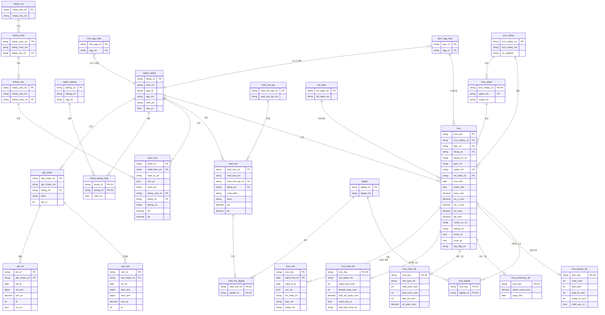
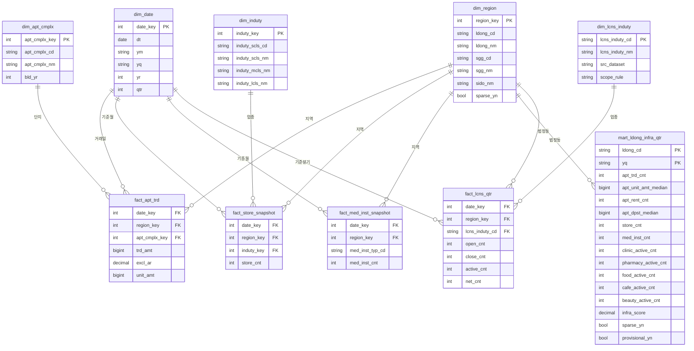

# 07. 데이터 모델: Silver ERD와 Gold 스타 스키마

> **이 문서의 출처**
> - `docs/설계서_초안.md` — ERD 초안: Silver 정규화 모델 (L147–385), Gold 스타 스키마 (L387–495)
> - `docs/분석범위_제안.md` — 골드 (L372–380)
> - `docs/silver_정제.md` — 3-6 골드 집계 기준 (고정) (L118–131)
> - `/INTENT.md` — 3장 ① 스타 스키마 통합 (L29–32)
> - `/plan.md` — 3. Gold 체크리스트 (L54–61)
>
> ⚠ **이 문서의 스키마는 초안입니다.** `INTENT.md`는 "세부 Fact/Dimension 구조는 `SPEC.md` 단계에서 결정"한다고 했고, `plan.md`는 **2026-11-20 오후 논의에서 확정**(`dim_region` 법정동 기준, 법정동 × 분기 fact)한 뒤 팀 합의 내용만 문서화한다고 정했습니다. 확정되면 이 문서를 그 결과에 맞춰야 합니다(5장).
>
> 이전 문서: `06_Silver_정제_03단계.md` · 다음 문서: `08_ML_데이터셋과_적재DB.md`

---

## 1. 모델링 방향

> 출처: `설계서_초안.md` § ERD 초안 (L147–158)

Silver는 3NF로 나누고, Gold는 법정동 단위 dim_region을 중심으로 한 스타 스키마로 다시 묶습니다. 단계마다 테이블이 더해지지만 지역 테이블은 하나만 유지합니다.

아래 ERD는 3차(정규화)·4차(Gold)에서 만들 테이블의 초안입니다. 테이블·컬럼 이름은 3차를 진행할 때 표준용어(대문자 접미사 규칙, `05_Silver_표준화_02단계.md` 4장)에 맞춰 바꿉니다.

| 단계 | 추가되는 Silver 테이블 |
| --- | --- |
| 1단계 | region_ldong, apt_cmplx, apt_trd, apt_rent |
| 2단계 | region_adong, ldong_adong_map, induty_lcls, induty_mcls, induty_scls, store_hist |
| 3단계 | hira_sgg_map, med_inst_typ, med_inst, dgsbjt, med_inst_dgsbjt |
| 4단계 | lgov_sgg_map, trd_state, lcns_induty, lcns_uptae, lcns, lcns_hist, lcns_food_dtl, lcns_clinic_dtl, lcns_pharmacy_dtl, lcns_beauty_dtl, lcns_dgsbjt |

> ⚠ **미결:** 03 산출물을 이 3NF(`lcns` + `lcns_*_dtl`)로 바로 나눌지, 업종별 파일로 두고 다음 단계에서 나눌지는 아직 정하지 않았습니다(`silver_정제.md` 8장 2번).

---

## 2. Silver · 정규화 모델

> 출처: `설계서_초안.md` § Silver · 정규화 모델 (L160–385)

### Silver 테이블 설명

- **apt_trd / apt_rent**는 같은 단지를 참조하는 하위 타입입니다. 공통 속성이 늘어나면 상위 테이블 apt_ctrt로 합칩니다.
- **store_hist**는 SCD Type 2입니다. 분기 스냅샷을 비교해 업종·상호·위치가 바뀔 때만 새 행을 만듭니다.
- 법정동과 행정동은 M:N이라 **ldong_adong_map**이 필요합니다. main_yn은 행정동 집계 때 쓸 대표 매핑입니다.
- **hira_sgg_map**은 심평원 시군구 코드를 법정동 시군구 코드로 바꾸는 매핑 테이블입니다. 동 단위는 좌표나 주소로 찾습니다.
- 4단계는 인허가 5개 업종을 **공통 컬럼 통합 테이블(lcns) + 업종별 고유 컬럼 테이블(lcns_\*_dtl)** 로 나눕니다(2026-11-19, Gold를 법정동 × 분기 × 업종으로 정하면서 `분석범위_제안.md` 구조를 따름. 이전 안은 음식점 2종만 담은 food_lcns). 업종을 추가해도 공통 테이블 구조는 그대로입니다.
- **lcns_induty**는 `food_general`(일반음식점) / `food_rest`(휴게음식점) / `clinic` / `pharmacy` / `beauty` 5행입니다. lcns_uptae.scope_cd는 업종 내부 범위(카페·편의점·제외, 의원/치과/한의원, 보건소 제외 등)를 표시하고, 카페처럼 상호 키워드가 필요한 규칙은 Gold의 dim_lcns_induty.scope_rule에 둡니다.
- **lcns**는 최신 스냅샷 기준 업소 1행입니다(원천 중복 `MGTNO`는 여기서 1행으로). **lcns_hist**는 월간 스냅샷을 비교해 상태·상호·업태가 바뀐 경우만 새 행을 만드는 SCD Type 2입니다.
- **area_num**은 업종별 면적 컬럼을 하나로 모은 값입니다(음식점·미용업 소재지면적, 의원 총면적, 약국 영업면적). 원래 컬럼은 고유 테이블에도 남깁니다.
- **ldong_src_cd**는 법정동코드를 어디서 얻었는지 표시합니다: 일반음식점 보조 원천의 `법정동코드`(`food_general_file`) → 지번주소 매칭 → 도로명주소 괄호 동명 순서입니다.
- **move_yn**은 의원 영업상태 `05` 전출(812건)처럼 폐업이 아닌 '이전'을, **susp_yn**은 휴업(영업으로 집계)을 표시합니다. **qlty_flag_txt**에는 1900년 인허가일, 미래 폐업일, 서울 범위 밖 좌표, 깨진 문자 같은 품질 플래그를 남깁니다.
- **lcns_dgsbjt**는 의원 진료과목 목록(`DGSBJT_CD_TXT`)을 나눈 M:N 테이블로, 3단계 심평원 dgsbjt 코드와 대조해 연결합니다(코드 체계 일치 여부는 3차에서 확인).
- **lgov_sgg_map**은 개방자치단체코드(3220000 등 7자리)를 시군구코드로 바꾸는 25행 매핑입니다. 법정동코드는 지번주소 앞 3어절을 법정동명과 정확 일치로 찾고(99.9%), 실패하면 도로명주소 괄호 안 동명으로 다시 찾습니다. 매핑 실패율은 3차 결과에 기록합니다.
- **좌표** (2026-11-19 결정 변경, 이전: 변환 안 함): 2차 silver는 원천 TM 원값(`TM_X_NUM`/`TM_Y_NUM`)을 그대로 두고, 3차에서 WGS84 위경도(`lon_num`/`lat_num`, EPSG:4326)를 추가합니다. 인허가 API의 X/Y는 EPSG:5174, 일반음식점 보조 원천(CSV)의 `X좌표`/`Y좌표`는 EPSG:5179(값 범위로 추정)입니다. 일부 출처가 EPSG:2097로 안내되어 있어 변환 결과를 법정동 경계 폴리곤과 point-in-polygon으로 대조해 좌표계를 확정합니다. 일반음식점은 보조 원천 좌표를 우선 쓰고 API 좌표로 보완하며, 어느 쪽을 썼는지 `coord_src_cd`에 남깁니다. 좌표로 행정동 코드(`adong_cd`)도 부여해 Silver에 보존합니다(Gold 집계는 법정동).

> ⚠ **문서 간 차이 — `lcns` 컬럼 (`silver_정제.md`, 2026-11-20 초안):**
> - `move_yn`·`susp_yn`·`qlty_flag_txt` 대신 → 출처 컬럼(`*_SRC_CD`) + 연결 컬럼(`MOVE_PRE_KEY`, `REPL_PRE_KEY`/`REPL_TYPE_CD`) + 집계 제외 후보 플래그 3개(`ABNRM_LCNS_DTM_YN`, `OUT_SEOUL_ADDR_YN`, `OUT_SCOPE_YN`) + `report/silver/03_silver__issue_list.csv`
> - 휴업은 플래그 없이 영업 상태 출처 `휴업_영업간주`로 표시
> - 카페 키워드 규칙 위치: Gold `scope_rule` 대신 `metadata/cln_induty_rule.csv`
> - 좌표: **03에서는 WGS84 변환·`adong_cd` 부여를 하지 않음.** 어느 단계에서 할지 팀 결정 필요
> → `06_Silver_정제_03단계.md` 0장 비교표, `10_진행현황_체크리스트와_미결사항.md`

---

## 3. Gold · 스타 스키마

> 출처: `설계서_초안.md` § Gold · 스타 스키마 (L387–495)

### Gold 테이블 설명

- **dim_induty**는 대·중·소분류를 한 행에 펼친 비정규화 차원입니다. Silver에서는 나누고 Gold에서는 합치는 것이 이 프로젝트의 핵심 연습입니다. **unit_amt**는 ㎡당 거래금액이고, **infra_score**는 지표를 min-max 정규화해 합산한 값입니다.
- **Gold의 키는 법정동 × 분기 × 업종**입니다(2026-11-19 결정 변경, 이전: 행정동 × 월). 기간은 2017년 1분기 ~ 2025년 4분기이고, 2026년 분기는 잠정치(`provisional_yn`)로 표시합니다. 근거는 `01_프로젝트_개요와_분석범위.md` 3-3·3-5: 실거래가 API가 법정동 기준이라 손실 없이 결합되고, 법정동 경계는 9년간 거의 바뀌지 않으며, 동 하나당 업소·거래 수가 작아 월 단위로는 0이 대부분입니다.
- **fact_lcns_qtr**는 인허가 5개 업종(의원, 약국, 일반음식점, 휴게음식점(카페), 미용업)의 분기 집계입니다. open_cnt는 그 분기 인허가일 건수, close_cnt는 그 분기 폐업일 건수, active_cnt는 분기말 기준 인허가일 ≤ 분기말 < 폐업일(또는 영업 중)인 업소 수(재고), net_cnt는 open − close입니다. 개업 건수가 적은 의원·약국은 active_cnt를 주 지표로 씁니다. 업종 내부 범위(카페 = 업태 + 상호 키워드 규칙 등)는 dim_lcns_induty의 scope_rule에 기록합니다.
- **mart_ldong_infra_qtr**는 법정동 × 분기 1행의 넓은 표입니다. 실거래 지표는 분기 중앙값과 거래 수이며, 매매는 `sggCd`+`umdCd`(10자리 법정동코드), 전월세는 `sggCd`+`umdNm`을 법정동코드표와 매칭해 붙입니다. 업소·거래 수가 기준 미만인 동은 sparse_yn으로 표시합니다. 일 단위 이벤트는 Silver에 남아 있으므로 구 단위 등 큰 단위에서는 월 집계도 다시 만들 수 있습니다.

### 골드 지표 정의 (분석범위 제안)

> 출처: `분석범위_제안.md` § 골드 (L372–380)

- **키:** 법정동 코드 × 분기 × 업종
- **인프라 지표:** 개업 수, 폐업 수(각각 전체 / 교체 제외), 기말 영업 수, 순증, (선택) 평균 영업 기간
- **부동산 지표:** 아파트 매매가 분기 중앙값과 거래 수, 전월세 분기 중앙값과 거래 수
  - **매매:** 수집된 데이터의 `sggCd`(5자리)와 `umdCd`(5자리)를 이으면 10자리 법정동코드가 됩니다.
  - **전월세:** `umdCd`가 없어서 `sggCd` + `umdNm`(동 이름)을 법정동코드표(bronze `ldong_code`)와 매칭합니다. (`silver_정제.md` [G4]: 현행 법정동 코드표와 100% 매칭 확인)
- **품질 플래그:** 희소 동 플래그(업소·거래 수가 기준 미만인 동), 2026년 잠정치 플래그
- 의원·약국처럼 개업 건수가 적은 업종은 동 × 분기로 쪼개면 대부분 0~1건이 됩니다. 이런 업종은 **기말 영업 수(재고)** 를 주 지표로 쓰는 것이 안정적입니다.

---

## 4. 골드 집계 기준 (고정)

> 출처: `silver_정제.md` § 3-6 (L118–131) — 실버(03)와 골드가 같이 지켜야 하는 기준

골드는 03 silver를 직접 읽지 않고 **진입 함수**를 거쳐 읽습니다(`06_Silver_정제_03단계.md` 3-5). 진입 함수의 반환 컬럼 약속과 개업·폐업 구분 값은 골드 문서에서 정하기로 되어 있고(미결), 아래 집계 기준만 고정합니다.

| 항목 | 기준 |
|---|---|
| 분기 말 재고 | 분석용 개업일 ≤ 분기 말 **<** 분석용 폐업일 (분석용 폐업일이 없으면 영업 중) |
| 개업 수 / 폐업 수 | 분석용 개업일 / 분석용 폐업일이 그 분기 안. 개업 수에서는 `ABNRM_LCNS_DTM_YN` 제외 |
| 법정동 실패 | `LDONG_SRC_CD`가 `실패*`(`실패`, `실패_서울밖`, `실패_전출주소`)이면 **동 집계에서 빠지고 구 집계(`LGOV_CD`)에는 남음**. 그래서 동 합계 ≤ 구 합계이고, 차이는 `change_log`에 남김 |
| 대상 업종 | `OUT_SCOPE_YN` 제외. 편의점은 참고 지표로 따로 |
| 두 벌 지표 | 개업·폐업은 전체 / 이전 제외 / 재등록 제외 / 교체·재등록 제외로 만들 수 있음. 재고는 하나 |
| 순증과 재고 증감 | **조정한 개업 − 폐업은 재고 증감과 같지 않습니다.** 예: 제이약국은 앞 레코드 2019-06-30 폐업, 뒤 레코드 2019-07-01 개업. 재등록으로 빼면 두 분기의 개업·폐업은 사라지지만, 2분기 말 재고 −1, 3분기 말 +1은 그대로 남음. 재고는 레코드 그대로 셉니다 |
| 분석 기간 | 2017Q1 ~ 2026Q3 (2026은 잠정). 분석 종료일은 인허가 수집일보다 앞이어야 함 |
| 실거래가 | `CNCL_YN` 제외, 서울은 `SGG_CD` 앞 2자리 `11` |
| 일반음식점 원천 | 03의 일반음식점 산출물 하나만 읽음 ([A1]) |

- 대용 값으로 채운 건수(폐업일 출처가 `최종수정일자_*`인 업소)는 골드 셀(법정동 × 분기 × 업종)마다 품질 지표로 넘깁니다. 업소 단위 AI 학습셋에는 출처 컬럼을 그대로 넘깁니다.

> ⚠ **문서 간 차이:**
> - 분석 기간: 설계서는 2017Q1~**2025Q4** + 2026 잠정, 이 기준은 2017Q1~**2026Q3**.
> - 두 벌 지표: 분석범위 제안은 "전체 / 교체 제외" 두 벌, 이 기준은 전체 / 이전 제외 / 재등록 제외 / 교체·재등록 제외.
> - 설계서의 `fact_lcns_qtr` 정의는 원본 인허가일·폐업일 기준이고, 이 기준은 **분석용** 개업일·폐업일(대용·이전 반영) 기준입니다.

---

## 5. Gold 구현 계획 (plan.md)

> 출처: `plan.md` § 3. Gold — 스타 스키마 (L54–61), § 1. 일정 (L13–14)

논의는 2026-11-20(금) 오후, 구현은 11/21(토) 오전, 검증·적재는 11/21 오후입니다.

- [ ] fact / dimension 테이블 구성 확정 (`dim_region` 법정동 기준, 법정동 × 분기 집계)
- [ ] 골드 진입 방식 결정 (silver 플래그를 어떻게 읽을지, 집계 기준은 `silver_정제.md` 3-6 → 이 문서 4장)
- [ ] 논의 결과 문서화 (팀 합의 내용만)
- [ ] `pipeline/gold/` 구현
- [ ] 검증: silver ↔ gold 행 수·합계 대조, 구 합계 = 동 합계, `report/gold/` 기록
- [ ] PostgreSQL 적재 (`.env` 연결, `SPEC.md` 4장)
- [ ] 문서 (`docs/gold_*.md` 또는 `SPEC.md` 갱신)

**매뉴얼에서 확인한 점**
- **`dim_region` 원천:** plan은 03에서 `ldong_code`를 기준 코드표로 정리해 `dim_region` 원천으로 씁니다(`06_Silver_정제_03단계.md` 8-1). 이 문서의 Silver `region_ldong` → Gold `dim_region` 흐름과 같습니다.
- **검증 기준 "구 합계 = 동 합계":** 4장 집계 기준은 법정동 실패 행이 동 집계에서 빠지고 구 집계에만 남으므로 **동 합계 ≤ 구 합계**이고 차이를 `change_log`에 남긴다고 정했습니다. 검증할 때는 "구 합계 = 동 합계 + 법정동 실패 건수"로 맞춰 보는 것이 4장과 맞습니다.
- **적재 DB:** plan은 PostgreSQL로 적재합니다. `08_ML_데이터셋과_적재DB.md` 2장의 PostgreSQL 권장안과 같은 방향입니다.
