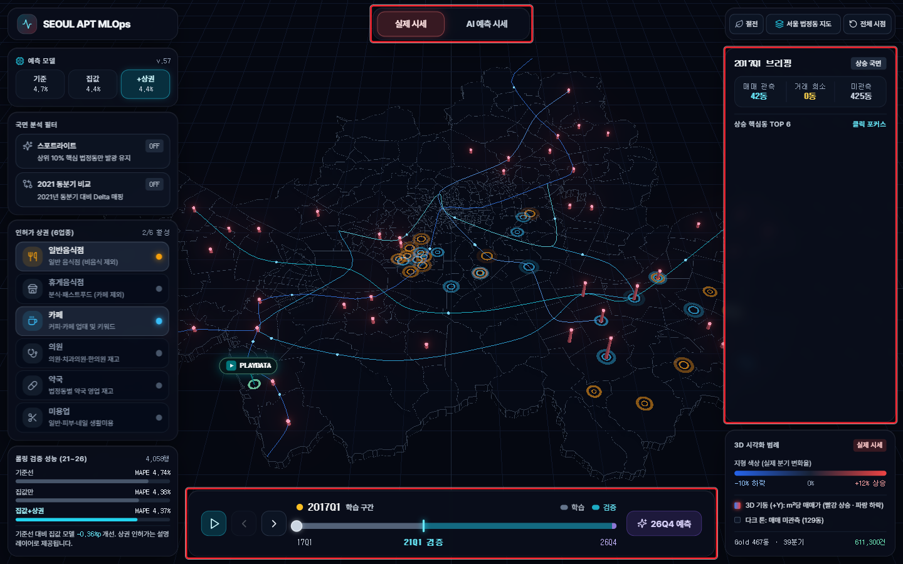
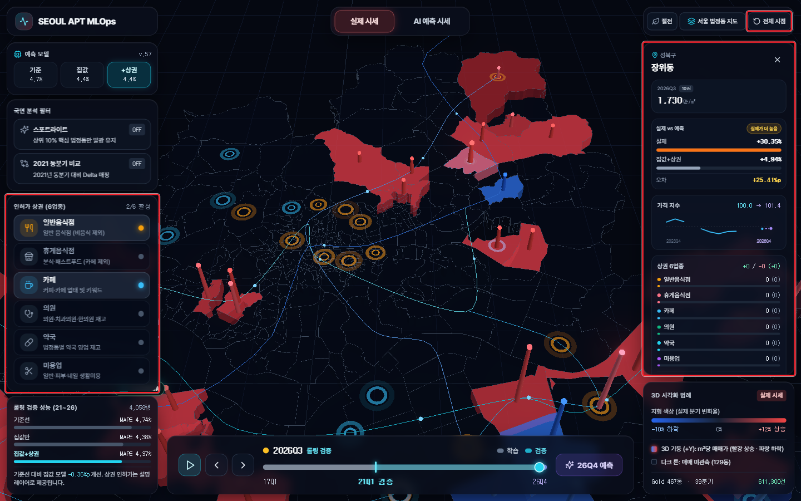
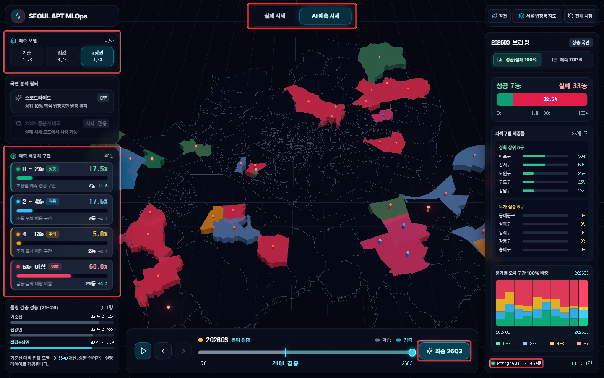
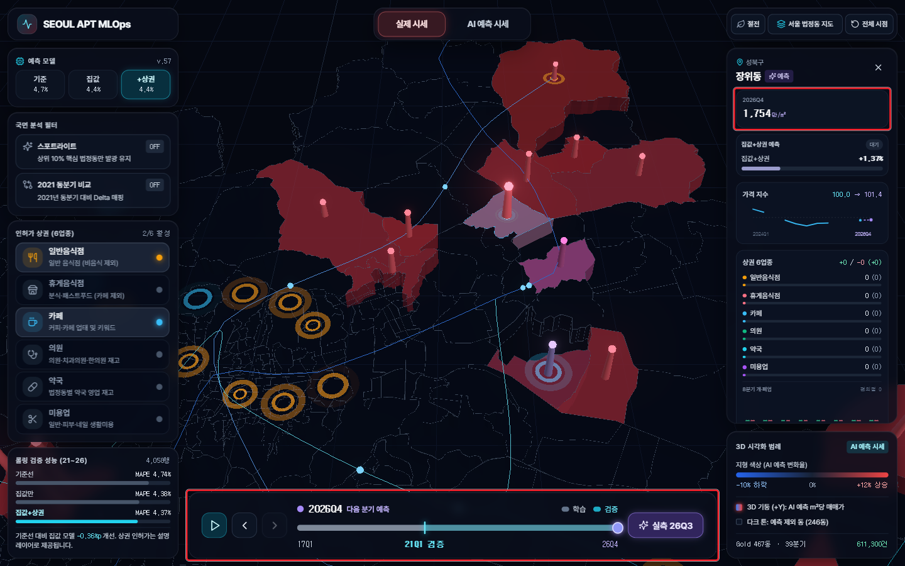

# 12. 서울 아파트 시세 대시보드 사용자 매뉴얼

이 대시보드에서 서울 법정동별 아파트 매매 시세, 모델의 예측 결과, 주변 상권의 변화를 분기별로 볼 수 있습니다. 운영자에게 받은 대시보드 주소를 브라우저에서 여세요. 같은 PC에서 Docker Compose로 실행 중이라면 [대시보드 열기](http://localhost:5173)를 사용하세요.

아래 화면은 저장소의 비식별 샘플을 PostgreSQL에 적재한 뒤 ego-lite에서 캡처했습니다. 빨간 박스는 각 단계에서 확인하거나 누를 위치를 가리킵니다. 운영 환경에서는 시세와 거래 건수가 달라질 수 있습니다.

## 1. 실제 시세와 분기 선택

1. 화면 위쪽에서 **실제 시세**를 선택합니다. 처음 열면 `2017Q1`이 표시됩니다.
2. 아래쪽 타임라인에서 원하는 분기로 이동합니다. 슬라이더를 끌거나 좌우 버튼으로 한 분기씩 이동할 수 있습니다. ▶ 버튼을 누르면 분기를 순서대로 재생합니다.
3. 화면 오른쪽 브리핑에서 선택한 분기의 서울 전체 요약을 읽습니다. 아래쪽 **3D 시각화 범례**에서 지형 색상과 기둥의 의미를 확인합니다.

## 2. 지도에서 법정동과 상권 확인

1. 지도를 드래그해 이동하고 마우스 휠로 확대하거나 축소합니다. 처음 위치로 돌아가려면 오른쪽 위 **전체 시점**을 누릅니다.
2. 지도 위에서 법정동을 가리키면 오른쪽 상세가 바뀝니다. 지도에서 동을 클릭하거나 오른쪽 브리핑의 **상승 핵심동 TOP 6**에서 동을 선택하면 상세가 고정됩니다. **×**를 누르면 선택을 해제합니다.
3. 오른쪽 상세에 표시된 **법정동 이름**, 분기, 거래 건수, ㎡당 매매가(`만/m²`)를 확인합니다. **희소**는 거래 표본이 적은 구역이고 **미관측**은 해당 분기에 거래가 관측되지 않은 구역입니다. 아래로 스크롤하면 동일 단지 가격지수 추이와 상권의 영업·개업·폐업 현황을 볼 수 있습니다.
4. 왼쪽 **인허가 상권 (6업종)**에서 관심 업종을 켜거나 끕니다. **스포트라이트**로 상위 10% 동을 강조하고, **2021 동분기 비교**를 켜면 선택 분기를 2021년의 같은 분기와 비교합니다.

## 3. 모델의 예측 성능 비교

1. 위쪽에서 **AI 예측 시세**, 아래쪽에서 **최종 26Q3**를 눌러 마지막 롤링 검증 분기로 이동합니다. 타임라인에서 `2021Q1`부터 `2026Q3`까지의 검증 분기를 선택할 수 있습니다. `2017Q1`부터 `2020Q4`는 학습 구간입니다.
2. 왼쪽 **예측 모델**에서 **기준**, **집값**, **+상권**을 바꿔가며 같은 분기를 비교합니다.
3. 왼쪽 **예측 허용치 구간**과 오른쪽 브리핑을 확인합니다. 오차는 실제 변화율에서 예측 변화율을 뺀 값이며 단위는 퍼센트포인트(`%p`)입니다. 법정동을 선택하면 **실제 vs 예측**과 개별 동의 오차를 볼 수 있습니다.
4. 동 선택을 해제한 상태에서 오른쪽 브리핑 아래의 **PostgreSQL · 467동** 표시로 데이터 연결을 확인합니다.

## 4. 다음 분기 예측 보기

1. 위쪽에서 **실제 시세**를 선택한 다음 아래쪽 **26Q4 예측**을 누릅니다.
2. 타임라인에 **2026Q4 다음 분기 예측**이 표시되었는지 확인합니다. 지도에서 동을 선택하면 오른쪽 카드에서 선택한 모델의 예측 ㎡당 가격을 볼 수 있습니다. 모델 산출물이 없는 동에는 **예측 제외**가 표시됩니다.
3. 관측 분기로 돌아가려면 **실측 26Q3**를 누릅니다.

## 화면이 느리거나 데이터가 비어 있을 때

| 증상 | 확인할 곳 |
| --- | --- |
| 지도 이동이 끊김 | 오른쪽 위 **절전**을 켭니다. **전체 시점**으로 지도의 기본 위치를 확인할 수 있습니다. |
| 지도 경계가 평소와 다름 | 오른쪽 위에 **서울 법정동 지도**가 표시되는지 확인합니다. **Fallback 그리드**가 계속 표시되면 운영자에게 알려주세요. |
| 동 상세가 비어 있음 | 먼저 선택한 분기와 **미관측**, **희소**, **예측 제외** 표시를 확인합니다. 여러 분기에서 시세가 비어 있거나 **PostgreSQL · 467동** 표시가 보이지 않으면 운영자에게 접속 주소와 분기를 전달합니다. |

서비스 기동과 데이터 갱신은 [운영자 매뉴얼](13_대시보드_운영자_매뉴얼.md)을 참고하세요.
