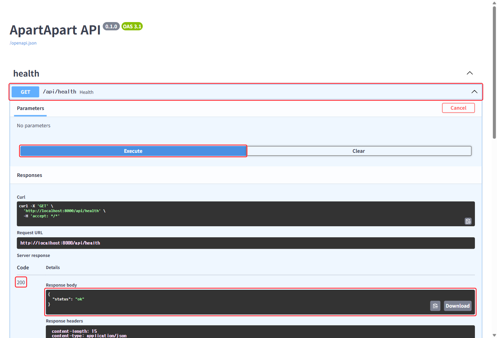
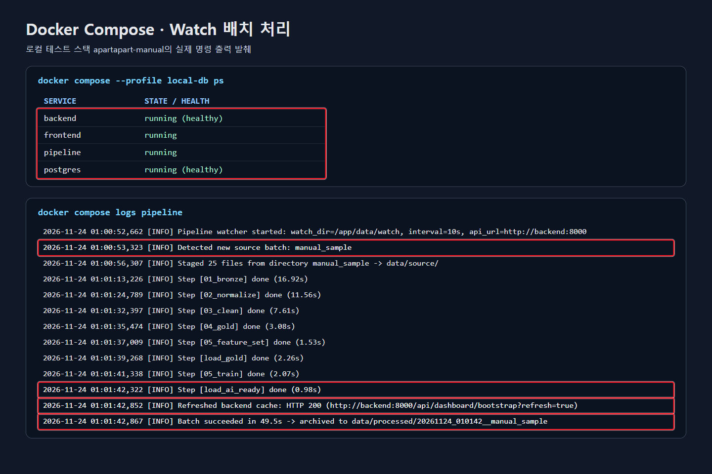

# 13. 서울 아파트 시세 대시보드 운영자 매뉴얼

Docker Compose로 서비스를 기동하고, Watch 폴더로 데이터를 반영하고, API와 대시보드에서 결과를 확인하는 절차입니다. 명령은 저장소 루트의 PowerShell에서 실행합니다.

## 1. 실행 환경 준비

1. Docker Desktop을 시작하고 `docker info`가 서버 정보를 표시하는지 확인합니다.
2. 처음 실행할 때 `.env`가 없으면 템플릿을 복사합니다.

   ```powershell
   if (!(Test-Path .env)) { Copy-Item .env.example .env }
   ```

3. 로컬 DB에서는 `.env`의 `DBHOST=postgres`, `DBPORT=5432`를 사용합니다. 팀 공용 DB에서는 `.env`의 `DBHOST`, `DBPORT`, `DBNAME`, `DBID`, `DBPW`, `DBSSLMODE`를 운영 환경에 맞춰 설정합니다. 비밀번호와 수집 API 키는 `.env`에서 관리합니다.

| 서비스 | 확인 위치 | 역할 |
| --- | --- | --- |
| `frontend` | `http://localhost:5173` | 3D 대시보드와 `/api/*` 프록시 |
| `backend` | `http://localhost:8000/docs` | FastAPI와 API 문서 |
| `postgres` | 호스트 `5432` 기본값 | `local-db` 프로필에서 PostgreSQL 기동. 신규 볼륨의 스키마는 `db/01_schema.sql`로 초기화 |
| `pipeline` | `docker compose logs pipeline` | Watch 폴더 감시, 전처리·학습·DB 적재 |

## 2. 기동하고 서비스 상태 확인

로컬 DB를 포함한 네 서비스를 실행합니다.

```powershell
docker compose --profile local-db up --build -d
docker compose --profile local-db ps
```

`ps`에서 `postgres`, `backend`는 `healthy`, `frontend`, `pipeline`은 `Up` 상태인지 확인합니다. `postgres`의 호스트 포트가 이미 사용 중이면 `.env`의 `LOCAL_DBPORT`를 바꿀 수 있습니다. 컨테이너 간 접속 포트는 `DBPORT=5432`입니다.

팀 공용 DB로 화면과 API만 제공할 때는 `docker compose up --build -d backend frontend`를 사용합니다. 팀 DB 적재까지 담당하는 환경에서 `docker compose up --build -d`를 실행하면 Watch 워처도 함께 기동합니다. 공용 DB 연결 상태에서 Watch에 배치를 제출하면 해당 DB로 적재됩니다.

## 3. API 연결 확인

1. [Swagger UI](http://localhost:8000/docs)에서 **GET /api/health**를 펼칩니다.
2. **Try it out → Execute**를 누르고 **HTTP 200**과 `{"status":"ok"}`를 확인합니다. 이 검사는 백엔드가 PostgreSQL에서 `SELECT 1`을 실행할 수 있는지 확인합니다.
3. 프론트 경유 연결은 `Invoke-RestMethod http://localhost:5173/api/health`로 확인합니다.



## 4. Watch 폴더로 데이터 갱신

1. 신규 원천 파일을 `api/` 또는 `files/`가 들어 있는 폴더나 ZIP으로 준비합니다. `data/source/`에는 운영자가 파일을 직접 편집하지 않고, 원천 등록은 Watch 인입 절차로 진행합니다. Bronze 단계에서 SHA-256을 검증합니다.
2. 배치마다 고유한 이름을 사용하고 `data/watch/`에 복사합니다. 복사하는 동안 `.part` 접미사를 붙이고, 복사가 끝나면 제거합니다. 기본 폴링 간격은 10초, 수정이 멈춘 뒤 대기 시간은 2초입니다.

   아래 예시는 저장소의 비식별 샘플로 전체 흐름을 확인하는 **별도 로컬 테스트 체크아웃**에서 실행합니다. 이 예시를 실행하면 테스트 환경의 DB에 샘플 데이터가 적재됩니다.

   ```powershell
   $batch = 'sample-' + (Get-Date -Format 'yyyyMMdd-HHmmss')
   New-Item -ItemType Directory -Force data/watch | Out-Null
   Copy-Item -Recurse samples/local_e2e/source "data/watch/$batch.part"
   Rename-Item "data/watch/$batch.part" $batch
   docker compose logs -f pipeline
   ```

3. 로그에서 `Detected new source batch`, 단계별 `done`, `Refreshed backend cache: HTTP 200`, `Batch succeeded`를 확인합니다. 성공한 배치는 `data/processed/<타임스탬프>__<배치명>`으로 이동합니다. `Ctrl+C`로 로그 보기를 끝낼 수 있습니다.
4. `Batch failed`가 나오면 `report/pipeline_watch.log`에서 실패한 단계와 메시지를 확인합니다. 실패 배치는 `data/quarantine/`에 보관합니다. 입력과 원인을 확인한 후 수정한 묶음을 새 이름으로 제출합니다. Gold와 AI Ready는 별도로 적재되므로 중간 실패가 나면 적재 로그와 API 응답을 함께 확인합니다.

별도 로컬 테스트 스택의 `ps`와 `logs` 출력에서 확인할 줄을 발췌했습니다.



## 5. 반영 확인과 장애 대응

샘플 적재 후 아래 명령으로 데이터 소스, 분기 수, 분기별 예측 건수를 확인할 수 있습니다. 샘플에서는 `source=postgres`와 0보다 큰 분기 수, `2026Q3` 및 `2026Q4`의 예측 건수가 나와야 합니다.

```powershell
$api = 'http://localhost:8000/api/dashboard'
$boot = Invoke-RestMethod "$api/bootstrap?refresh=true" -TimeoutSec 60
[pscustomobject]@{ source = $boot.source; quarters = $boot.quarters.Count }
foreach ($quarter in '2026Q3', '2026Q4') {
    $payload = Invoke-RestMethod "$api/quarters/$quarter"
    $predicted = @($payload.records.PSObject.Properties.Value |
        Where-Object { $null -ne $_.predictedGrowth }).Count
    [pscustomobject]@{ quarter = $quarter; predicted = $predicted }
}
```

[대시보드](http://localhost:5173)를 새로고침합니다. **AI 예측 시세 → 최종 26Q3**로 이동해 오른쪽 브리핑 아래에 **PostgreSQL · 467동**이 표시되는지 확인합니다. 동 상세가 열려 있으면 **×**로 닫습니다. 이번 로컬 검증에서는 `source=postgres`, 40개 분기, `2026Q3` 예측 40개 동, `2026Q4` 예측 42개 동을 확인했습니다. 운영 데이터의 거래·예측 대상 수는 달라질 수 있습니다.

| 증상 | 확인 순서 |
| --- | --- |
| `docker info` 서버 연결 실패 | Docker Desktop을 시작한 후 다시 확인합니다. |
| `/api/health`가 503 | `docker compose --profile local-db ps`와 `docker compose logs --tail 100 backend postgres`를 확인합니다. 공용 DB에서는 네트워크·VPN과 `.env`의 DB 연결 정보를 확인합니다. |
| DB 연결은 되지만 시세가 비어 있음 | `bootstrap`의 소스와 데이터, `load_gold`·`load_ai_ready` 결과를 확인합니다. 헬스체크는 테이블 내용까지 검사하지 않습니다. |
| Watch 배치가 처리되지 않음 | `pipeline` 상태, `data/watch/` 아래 위치, 임시 확장자, `api/`·`files/` 구조와 로그를 확인합니다. |
| 배치 성공 뒤 화면이 갱신되지 않음 | 캐시 갱신 경고를 확인하고 `bootstrap?refresh=true`를 다시 호출한 뒤 화면을 새로고침합니다. |
| 정제·학습 결과 확인 필요 | `report/pipeline_watch.log`에서 실패 단계부터 확인하고, `report/bronze/`, `report/silver/`, `report/gold/`, `report/ai_ready/`에서 해당 단계 실행 기록을 확인합니다. |

## 6. 재시작과 종료

```powershell
# 워처 코드 또는 metadata 규칙 변경 적용
docker compose --profile local-db up --build -d --no-deps pipeline

# 서비스 종료 및 DB 볼륨 유지
docker compose --profile local-db down
```

워처를 재시작하거나 종료하기 전에 진행 중인 배치가 완료되었는지 로그에서 확인합니다. 공용 DB 구성에서는 해당 기동·종료 명령에서 `--profile local-db`를 뺍니다. `down -v`는 로컬 DB 볼륨을 삭제합니다.

전체 원천으로 수동 실행하는 옵션과 컨테이너 세부 구성은 [로컬 Docker E2E 실행 가이드](11_로컬_Docker_E2E_실행가이드.md)를 참고하세요. 화면 조작은 [사용자 매뉴얼](12_대시보드_사용자_매뉴얼.md)에 정리되어 있습니다.
