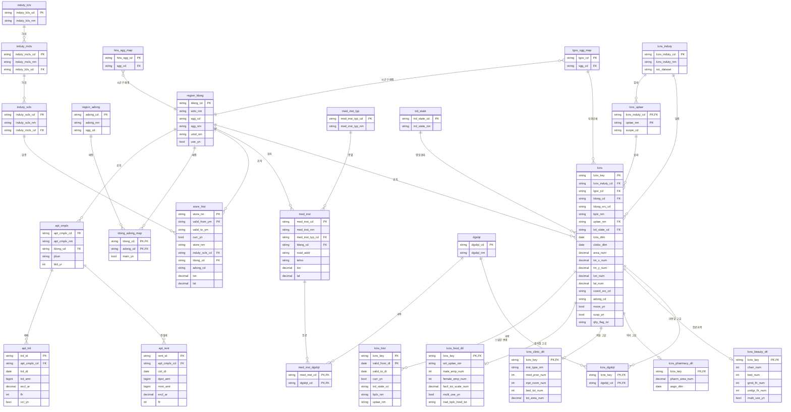
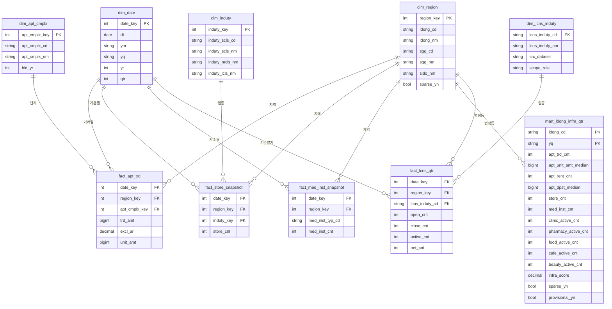

# 동네 생활 인프라 데이터 프로젝트 설계서

Nov 18, 2026 · @상효

## 개요

이 프로젝트는 공공데이터 3종을 **지역 코드 하나로 묶는 것**을 목표로 합니다. 부동산 실거래가 → 상가 → 병원·약국 순서로 붙여 나가며, 마지막에는 **법정동 × 분기** 단위의 "동네 생활 인프라 지표"를 만듭니다(2026-11-19 결정 변경, 이전 안은 행정동 × 월. 아래 "결정 변경" 참고).

순서를 이렇게 잡은 이유는 단계마다 난이도가 하나씩 올라가기 때문입니다.

| 단계 | 붙이는 데이터 | 지역을 잇는 방법 | 새로 연습하는 개념 |
| --- | --- | --- | --- |
| 1단계 | 아파트 매매·전월세 실거래가 (API) | 응답의 시군구코드 + 읍면동코드 → 10자리 법정동코드 | 표준용어·도메인 정의, 금액·날짜 표준화, 1:N 정규화, 매매/전월세 하위 타입 |
| 2단계 | 상가(상권)정보 (분기 CSV) | 파일에 법정동코드·행정동코드가 이미 들어 있음 | 업종 3단계 계층, 법정동↔행정동 매핑, 분기 스냅샷 이력(SCD2) |
| 3단계 | 병원·약국 정보 (심평원 API) | 심평원 자체 시도·시군구 코드라 법정동과 다름 → 주소 또는 좌표로 매핑 | 이기종 코드 매핑, 진료과목 M:N, 코드 매핑 테이블 관리 |
| 4단계 | 서울시 인허가 5종: 일반·휴게음식점, 의원, 약국, 미용업 (서울 열린데이터광장 API, 월 1회 전체 스냅샷) | 자치단체코드 → 시군구(매핑 25행), 지번주소 → 법정동코드(문자열 매칭 99.9%) | 인허가 이력(개업·폐업 흐름), 월간 스냅샷과 변경 감지, 원천 중복 처리 |

핵심은 dim\_region(지역 차원)입니다. 1단계에서 법정동 기준으로 만들고, 2단계에서 행정동을 더하고, 3단계에서 다른 기관 코드까지 흡수합니다. 지역 차원이 단단할수록 뒤에 붙는 데이터가 쉬워집니다.

상가정보가 '지금 영업 중인 업소'의 분기 스냅샷이라면, 4단계의 인허가 정보(음식점·의원·약국·미용업)는 폐업 업소까지 포함한 이력입니다. 의원·약국 인허가는 3단계 심평원 현황(스냅샷)의 과거 시점을 재구성하는 원천이기도 합니다. 두 데이터는 공통 식별자가 없으므로 업소 단위로 합치지 않고 법정동 × 분기 단위에서만 결합합니다.

마포·강남·송파 3개 구로 시작해 지금은 **서울 25개 구(매매 2006-01\~, 전월세 2011-01\~)와 인천·경기 69개 시군구 코드(2020-01\~)의 2026-09까지** 실거래가를 모두 수집했습니다.

## 아키텍처

&#91;embedded content: 메달리온 파이프라인 · 소스 3개, 계층 3개\]

소스는 단계별로 추가되지만 Bronze→Silver→Gold 구조는 처음부터 고정합니다. 각 계층은 PC 프로젝트 폴더(`infra-data-pipeline`)에 parquet 파일로 쌓고, 실제 적재 DB는 MariaDB와 PostgreSQL 중에서 정합니다(아래 '적재 DB 선택' 참고).

## 표준용어 정의서

Silver 컬럼은 영문 대문자 표준단어를 `_`로 잇고, **마지막 단어(접미사)가 값의 종류와 저장 타입**을 정합니다. 실제 컬럼 정의 377개는 프로젝트의 `Dictionary.md`에 있고, `02_normalize.py`가 그 표를 그대로 읽어 변환합니다.

| 접미사 | 뜻 | 저장 타입 | 예 |
| --- | --- | --- | --- |
| `_KEY` | 개체를 식별하는 키 (자연키) | STRING | STORE\_KEY, MED\_INST\_KEY, APT\_KEY |
| `_CD` | 분류·체계 코드 | STRING | LDONG\_CD, INDUTY\_SCLS\_CD |
| `_NM` | 명칭 | STRING | STORE\_NM, APT\_NM |
| `_DTM` | 시간 (날짜 또는 시각) | DATE / TIME | DEAL\_DTM, ESTB\_DTM |
| `_NUM` | 숫자 (개수·금액·면적·층·좌표) | INT64 / FLOAT64 | DEAL\_AMT\_NUM, EXCL\_AREA\_NUM |
| `_YN` | 여부 | BOOL | CNCL\_YN |
| `_ADDR` | 주소 | STRING | ROAD\_ADDR, JIBUN\_ADDR |
| `_TEL` | 전화번호 | STRING | MED\_INST\_TEL |
| `_TXT` | 형식이 정해지지 않은 텍스트·원문 | STRING | CNTRCT\_TERM\_TXT |

- 원천 필드명은 Bronze에만 남기고, Silver부터는 표준용어만 사용
- 한글 용어명은 행정안전부 공공데이터 공통표준용어를 기준으로 하고, 영문 약어는 이 프로젝트의 규칙
- 이름·타입·규칙을 바꿀 때는 코드가 아니라 `Dictionary.md` 표를 고치고, 같은 문서의 "변경 이력"에 한 줄을 남김

### 표준단어

| 약어 | 뜻 | 약어 | 뜻 | 약어 | 뜻 |
| --- | --- | --- | --- | --- | --- |
| SIDO | 시도 | SGG | 시군구 | UMD / EMD | 읍면동 |
| LDONG | 법정동 | ADONG | 행정동 | PNU | 필지고유번호 |
| INDUTY | 업종 | LCLS / MCLS / SCLS | 대 / 중 / 소분류 | KSIC | 표준산업분류 |
| BLDG | 건물 | FLR | 층 | ROAD | 도로명 |
| MED\_INST | 요양기관 | INST\_TYPE | 종별 | DGSBJT | 진료과목 |
| TRMT | 진료 | BGN / END | 시작 / 종료 | ESTB | 개설 |
| DEAL | 거래·계약 | AMT | 금액 | DPST | 보증금 |
| EXCL\_AREA | 전용면적 | CNCL | 해제 | RGST | 등기 |
| CNTRCT | 계약 | SE | 구분 | LON / LAT | 경도 / 위도 |
| LCNS | 인허가 | LGOV | 자치단체 | BPLC | 사업장 |
| TRD\_STATE | 영업상태 | DTL | 상세 | CLSBIZ | 폐업 |
| UPTAE | 업태 | SNT | 위생 | TM | 평면직각좌표(TM) |
| EMP | 종업원 | FCTY / HQ | 공장 / 본사 | GRNT | 보증 |
| FACIL | 시설 | TRAD | 전통 | UPD | 데이터 갱신 |
| VCNTY | 주변 | GRD | 등급 | WTR\_SPLY | 급수 |

### 표준도메인 · 변환 규칙

| 규칙 | 결과 타입 | 하는 일 | 실패로 보는 경우 |
| --- | --- | --- | --- |
| `TRIM` / `TEXT` | STRING | 앞뒤 공백 제거(TEXT는 연속 공백 1칸), 빈 값 → NULL | 없음 |
| `NAME` | STRING | TEXT + 전각 영문·숫자·기호를 반각으로. 한글 자모(ㆍ)는 그대로 | 없음 |
| `CODE` / `CODE(n)` | STRING | TRIM + 대문자. n이 있으면 n자리로 0 채움(짧은 분류코드·우편번호만) | 없음 |
| `CONCAT` | STRING | 여러 원천 값을 이음 (실거래 sggCd+umdCd → LDONG\_CD) | 일부만 빈 경우 |
| `TEL` | STRING | 숫자만 추출 후 하이픈 표준형 (02-123-4567), 숫자가 없으면 NULL | 없음 |
| `INT` | INT64 | 쉼표·공백 제거 후 정수 | 정수가 아님 |
| `MANWON` | INT64 | 만원 → 원 (× 10,000) | 정수가 아님 |
| `FLOOR` | INT64 | 층 표기 → 정수 (B1 → -1) | `지`, `반지층` 등 |
| `FLOAT(n)` | FLOAT64 | 실수, 소수 n자리 반올림 (면적·좌표) | 숫자가 아님 |
| `DATE(형식)` / `YMD` | DATE | 날짜 해석, 분리된 년·월·일은 합침 | 형식 오류, 없는 날짜 |
| `TERM_BGN` / `TERM_END` | DATE | 계약기간 `A~B`의 시작 / 끝 월 | 형식 오류 |
| `HHMM` | TIME | 진료시간 `900` → 09:00, `0` → NULL | 시·분 범위 밖 |
| `YN(참;거짓)` | BOOL | 값 목록으로 참/거짓 판정 (해제여부 `O` → true) | 목록에 없는 값 |

변환에 실패한 값은 행을 지우지 않고 NULL로 두며, 그 행의 `STD_ERR_TXT`에 실패한 컬럼명을 남깁니다.

### 표준용어 (컬럼)

| 구분 | 용어명 | 컬럼명 | 타입 | 원천 필드 | 변환 규칙 |
| --- | --- | --- | --- | --- | --- |
| 공통 | 법정동코드 | LDONG\_CD | STRING | 실거래 sggCd+umdCd / 상가 법정동코드 | CONCAT / CODE |
| 공통 | 시군구코드 | SGG\_CD | STRING | 실거래 sggCd / 상가 시군구코드 | CODE |
| 공통 | 행정동코드 | ADONG\_CD | STRING | 상가 행정동코드 | CODE |
| 추적 | 원천 파일 경로 / 행 번호 | SRC\_FILE\_NM / SRC\_ROW\_NUM | STRING / INT64 | bronze \_source\_file / \_source\_row | TRIM / INT |
| 시스템 | 변환 실패 컬럼 | STD\_ERR\_TXT | STRING | (2차에서 생성) | — |
| 매매·전월세 | 단지 일련번호 / 단지명 | APT\_KEY / APT\_NM | STRING | aptSeq / aptNm | TRIM / NAME |
| 매매·전월세 | 계약일 | DEAL\_DTM | DATE | dealYear+dealMonth+dealDay | YMD |
| 매매·전월세 | 전용면적(㎡) / 층 / 건축년도 | EXCL\_AREA\_NUM / FLR\_NUM / BUILD\_YEAR\_NUM | FLOAT64 / INT64 | excluUseAr / floor / buildYear | FLOAT(4) / INT |
| 매매 | 거래금액(원) | DEAL\_AMT\_NUM | INT64 | dealAmount | MANWON |
| 매매 | 계약 해제 여부 | CNCL\_YN | BOOL | cdealType | YN(O;BLANK) |
| 전월세 | 보증금 / 월세(원) | DPST\_AMT\_NUM / MTHLY\_RENT\_AMT\_NUM | INT64 | deposit / monthlyRent | MANWON |
| 전월세 | 계약기간(원문) / 시작월 / 종료월 | CNTRCT\_TERM\_TXT / CNTRCT\_BGN\_DTM / CNTRCT\_END\_DTM | STRING / DATE | contractTerm | TRIM / TERM\_BGN / TERM\_END |
| 상가 | 상가업소번호 / 상호명 | STORE\_KEY / STORE\_NM | STRING | 상가업소번호 / 상호명 | TRIM / NAME |
| 상가 | 업종 소분류코드 | INDUTY\_SCLS\_CD | STRING | 상권업종소분류코드 | CODE |
| 상가 | 도로명주소 | ROAD\_ADDR | STRING | 도로명주소 | TEXT |
| 병원·약국 | 암호화 요양기호 / 요양기관명 | MED\_INST\_KEY / MED\_INST\_NM | STRING | 암호화요양기호 / 요양기관명 | TRIM / NAME |
| 병원·약국 | 종별코드 | INST\_TYPE\_CD | STRING | 종별코드 | CODE(2) |
| 병원·약국 | 전화번호 | MED\_INST\_TEL | STRING | 전화번호 | TEL |
| 병원·약국 | 개설일자 | ESTB\_DTM | DATE | 개설일자 | DATE(%Y-%m-%d) |
| 인허가 | 관리번호 / 사업장명 | LCNS\_KEY / BPLC\_NM | STRING | MGTNO / BPLCNM | TRIM / NAME |
| 인허가 | 개방자치단체코드 | LGOV\_CD | STRING | OPNSFTEAMCODE | CODE |
| 인허가 | 인허가일자 / 폐업일자 | LCNS\_DTM / CLSBIZ\_DTM | DATE | APVPERMYMD / DCBYMD | DATE(%Y-%m-%d) |
| 인허가 | 영업상태코드 | TRD\_STATE\_CD | STRING | TRDSTATEGBN | CODE(2) |
| 인허가 | 업태구분명 | UPTAE\_NM | STRING | UPTAENM | NAME |
| 인허가 | 좌표 X / Y (TM) | TM\_X\_NUM / TM\_Y\_NUM | FLOAT64 | X / Y | FLOAT(3) |
| 의원 | 의료인 수 / 병상 수 / 총면적 | MED\_PRSN\_NUM / BED\_TOT\_NUM / TOT\_AREA\_NUM | INT64 / INT64 / FLOAT64 | METRPNUM / SICBNUM / TOTAR | INT / INT / FLOAT(2) |
| 의원 | 진료과목 코드·명 목록(원문) | DGSBJT\_CD\_TXT / DGSBJT\_NM\_TXT | STRING | MEDEXTRITEMSCN / MEDEXTRITEMSCNNM | TEXT |
| 의원·약국 | 휴업 시작 / 종료일 | SUSP\_BGN\_DTM / SUSP\_END\_DTM | DATE | CLGSTDT / CLGENDDT | DATE(%Y-%m-%d) |
| 약국 | 영업면적 / 지정일자 | PHARM\_AREA\_NUM / ASGN\_DTM | FLOAT64 / DATE | PHARMTRDAR / ASGNYMD | FLOAT(2) / DATE(%Y-%m-%d) |
| 미용업 | 소재지면적 / 침대 수 | SITE\_AREA\_NUM / BED\_NUM | FLOAT64 / INT64 | SITEAREA / ABEDCNT | FLOAT(2) / INT |

위 표는 데이터셋을 잇는 핵심 컬럼만 추린 것입니다. 원천 필드명은 실제 응답·파일로 확인했고, 데이터셋별 전체 매핑은 `Dictionary.md` 4장에 있습니다.

## ERD 초안

Silver는 3NF로 나누고, Gold는 법정동 단위 dim\_region을 중심으로 한 스타 스키마로 다시 묶습니다. 단계마다 테이블이 더해지지만 지역 테이블은 하나만 유지합니다.

아래 ERD는 3차(정규화)·4차(Gold)에서 만들 테이블의 초안입니다. 테이블·컬럼 이름은 3차를 진행할 때 위 표준용어(대문자 접미사 규칙)에 맞춰 바꿉니다.

| 단계 | 추가되는 Silver 테이블 |
| --- | --- |
| 1단계 | region\_ldong, apt\_cmplx, apt\_trd, apt\_rent |
| 2단계 | region\_adong, ldong\_adong\_map, induty\_lcls, induty\_mcls, induty\_scls, store\_hist |
| 3단계 | hira\_sgg\_map, med\_inst\_typ, med\_inst, dgsbjt, med\_inst\_dgsbjt |
| 4단계 | lgov\_sgg\_map, trd\_state, lcns\_induty, lcns\_uptae, lcns, lcns\_hist, lcns\_food\_dtl, lcns\_clinic\_dtl, lcns\_pharmacy\_dtl, lcns\_beauty\_dtl, lcns\_dgsbjt |

### Silver · 정규화 모델



- apt\_trd와 apt\_rent는 같은 단지를 참조하는 하위 타입입니다. 공통 속성이 늘어나면 상위 테이블 apt\_ctrt로 합칩니다.
- store\_hist는 SCD Type 2입니다. 분기 스냅샷을 비교해 업종·상호·위치가 바뀜 때만 새 행을 만듭니다.
- 법정동과 행정동은 M:N이라 ldong\_adong\_map이 필요합니다. main\_yn은 행정동 집계 때 쓸 대표 매핑입니다.
- hira\_sgg\_map은 심평원 시군구 코드를 법정동 시군구 코드로 바꾸는 매핑 테이블입니다. 동 단위는 좌표나 주소로 찾습니다.
- 4단계는 인허가 5개 업종을 **공통 컬럼 통합 테이블(lcns) + 업종별 고유 컬럼 테이블(lcns\_\*\_dtl)**로 나눕니다(2026-11-19, Gold를 법정동 × 분기 × 업종으로 정하면서 `분석범위_제안.md` 구조를 따름. 이전 안은 음식점 2종만 담은 food\_lcns). 업종을 추가해도 공통 테이블 구조는 그대로입니다.
- lcns\_induty는 `food_general`(일반음식점) / `food_rest`(휴게음식점) / `clinic` / `pharmacy` / `beauty` 5행입니다. lcns\_uptae.scope\_cd는 업종 내부 범위(카페·편의점·제외, 의원/치과/한의원, 보건소 제외 등)를 표시하고, 카페처럼 상호 키워드가 필요한 규칙은 Gold의 dim\_lcns\_induty.scope\_rule에 둡니다.
- lcns는 최신 스냅샷 기준 업소 1행입니다(원천 중복 `MGTNO`는 여기서 1행으로). lcns\_hist는 월간 스냅샷을 비교해 상태·상호·업태가 바뀐 경우만 새 행을 만드는 SCD Type 2입니다.
- area\_num은 업종별 면적 컬럼을 하나로 모은 값입니다(음식점·미용업 소재지면적, 의원 총면적, 약국 영업면적). 원래 컬럼은 고유 테이블에도 남깁니다.
- ldong\_src\_cd는 법정동코드를 어디서 얻었는지 표시합니다: 일반음식점 보조 원천의 `법정동코드`(`food_general_file`) → 지번주소 매칭 → 도로명주소 괄호 동명 순서입니다.
- move\_yn은 의원 영업상태 `05` 전출(812건)처럼 폐업이 아닌 '이전'을, susp\_yn은 휴업(영업으로 집계)을 표시합니다. qlty\_flag\_txt에는 1900년 인허가일, 미래 폐업일, 서울 범위 밖 좌표, 깨진 문자 같은 품질 플래그를 남깁니다.
- lcns\_dgsbjt는 의원 진료과목 목록(`DGSBJT_CD_TXT`)을 나눈 M:N 테이블로, 3단계 심평원 dgsbjt 코드와 대조해 연결합니다(코드 체계 일치 여부는 3차에서 확인).
- lgov\_sgg\_map은 개방자치단체코드(3220000 등 7자리)를 시군구코드로 바꾸는 25행 매핑입니다. 법정동코드는 지번주소 앞 3어절을 법정동명과 정확 일치로 찾고(99.9%), 실패하면 도로명주소 괄호 안 동명으로 다시 찾습니다. 매핑 실패율은 3차 결과에 기록합니다.
- 좌표(2026-11-19 결정 변경, 이전: 변환 안 함): 2차 silver는 원천 TM 원값(`TM_X_NUM`/`TM_Y_NUM`)을 그대로 두고, 3차에서 WGS84 위경도(`lon_num`/`lat_num`, EPSG:4326)를 추가합니다. 인허가 API의 X/Y는 EPSG:5174, 일반음식점 보조 원천(CSV)의 `X좌표`/`Y좌표`는 EPSG:5179(값 범위로 추정)입니다. 일부 출처가 EPSG:2097로 안내되어 있어 변환 결과를 법정동 경계 폴리곤과 point-in-polygon으로 대조해 좌표계를 확정합니다. 일반음식점은 보조 원천 좌표를 우선 쓰고 API 좌표로 보완하며, 어느 쪽을 썼는지 `coord_src_cd`에 남깁니다. 좌표로 행정동 코드(`adong_cd`)도 부여해 Silver에 보존합니다(Gold 집계는 법정동).

### Gold · 스타 스키마



dim\_induty는 대·중·소분류를 한 행에 펼친 비정규화 차원입니다. Silver에서는 나누고 Gold에서는 합치는 것이 이 프로젝트의 핵심 연습입니다. unit\_amt는 ㎡당 거래금액이고, infra\_score는 지표를 min-max 정규화해 합산한 값입니다.

Gold의 키는 **법정동 × 분기 × 업종**입니다(2026-11-19 결정 변경, 이전: 행정동 × 월). 기간은 2017년 1분기 ~ 2025년 4분기이고, 2026년 분기는 잠정치(`provisional_yn`)로 표시합니다. 근거는 `분석범위_제안.md` 3·5장입니다: 실거래가 API가 법정동 기준이라 손실 없이 결합되고, 법정동 경계는 9년간 거의 바뀌지 않으며, 동 하나당 업소·거래 수가 작아 월 단위로는 0이 대부분입니다.

fact\_lcns\_qtr는 인허가 5개 업종(의원, 약국, 일반음식점, 휴게음식점(카페), 미용업)의 분기 집계입니다. open\_cnt는 그 분기 인허가일 건수, close\_cnt는 그 분기 폐업일 건수, active\_cnt는 분기말 기준 인허가일 ≤ 분기말 < 폐업일(또는 영업 중)인 업소 수(재고), net\_cnt는 open − close입니다. 개업 건수가 적은 의원·약국은 active\_cnt를 주 지표로 씁니다. 업종 내부 범위(카페 = 업태 + 상호 키워드 규칙 등)는 dim\_lcns\_induty의 scope\_rule에 기록합니다.

mart\_ldong\_infra\_qtr는 법정동 × 분기 1행의 넓은 표입니다. 실거래 지표는 분기 중앙값과 거래 수이며, 매매는 `sggCd`+`umdCd`(10자리 법정동코드), 전월세는 `sggCd`+`umdNm`을 법정동코드표와 매칭해 붙입니다. 업소·거래 수가 기준 미만인 동은 sparse\_yn으로 표시합니다. 일 단위 이벤트는 Silver에 남아 있으므로 구 단위 등 큰 단위에서는 월 집계도 다시 만들 수 있습니다.

## 결정 변경 (2026-11-19, `분석범위_제안.md` 반영)

`분석범위_제안.md`를 수집 결과와 대조한 뒤 아래 3가지를 바꿨습니다. 제안서 자체는 수정하지 않고, 이 설계서가 바뀐 결정을 따릅니다.

| # | 항목 | 이전 | 변경 | 영향 |
| --- | --- | --- | --- | --- |
| 1 | Gold 단위 | 행정동 × 월 (`mart_region_infra_monthly`, `fact_food_lcns_monthly`) | **법정동 × 분기 × 업종** (`mart_ldong_infra_qtr`, `fact_lcns_qtr`), 2017Q1 ~ 2025Q4 + 2026 잠정 | Gold ERD·4차 작업 목록 변경. 행정동은 Silver에 보존만 함 |
| 2 | 좌표 | TM 원값 유지, 위경도 변환 안 함 (2026-11-18) | **WGS84로 변환** (3차). EPSG:5174 / 5179를 변환하고 법정동 경계와 대조해 좌표계 검증 | 2차 silver(`TM_X_NUM`/`TM_Y_NUM`)는 그대로. 3차에 `lon_num`/`lat_num`/`adong_cd` 추가 |
| 3 | 일반음식점 원천 | 서울 API(OA-23056)만 사용 | **CSV(OA-16094)를 보조 원천으로 추가**해 `법정동코드`·`X좌표`·`Y좌표` 보완 | API에는 이 3개 컬럼이 없음. 2017년 이후 인허가 좌표 채움률 90.3% → 제안서 기준 99.7% |

- ERD 반영 (2026-11-19): Gold가 5개 업종을 다루게 되어 Silver 4단계도 음식점 전용(`food_lcns`)에서 **인허가 5종 공통 테이블 `lcns` + 업종별 고유 테이블 `lcns_*_dtl`**로 바꿨습니다(`분석범위_제안.md` 테이블 구조). `lcns`에는 위경도·행정동·좌표 출처·법정동 출처·이전/휴업·품질 플래그 컬럼을 넣었습니다.
- 1번 근거: 실거래가 API가 법정동 기준이라 지오코딩 없이 결합되고, 동 하나당 숫자가 작아 월 단위로는 0이 대부분입니다. 분기 집계는 법정동 400여 개 × 36분기 × 5업종 ≈ 7~8만 행입니다.
- 2·3번 근거: 행정동 부여와 좌표 검증(point-in-polygon)에 경계 폴리곤과 같은 좌표계가 필요하고, 일반음식점 API 좌표는 2017년 이후 인허가의 약 10%가 비어 있습니다.
- 3번 진행 상태 (2026-11-19 완료): 처음 내려받은 OA-16094 CSV는 39개 컬럼(API와 같음)이었고, 다시 받은 42개 컬럼 CSV를 `food_general_file` 데이터셋으로 추가했습니다(`00_collect.py import` → 01·02, 데이터 사전 42개 정의). cp949이고 원천에 깨진 바이트 4건이 있어 `encoding_errors="replace"`로 읽습니다. 01·02 모두 행 수 일치 1/1, 재실행 동일 1/1, 변환 실패 0칸. 관리번호 540,008건이 API 판과 모두 일치하고 인허가일자·TM 좌표 값도 같습니다. 2017년 이후 인허가 133,232건 중 법정동코드 98.5%, 좌표(API TM 또는 UTM-K) 99.8%가 채워집니다(둘 다 없음 332건). 3차에서 관리번호(`LCNS_KEY`)로 API 판과 연결해 `LDONG_CD`·`UTMK_X_NUM`/`UTMK_Y_NUM`을 붙입니다.
- 제안서와 맞춰 둔 사실 확인(2026-11-19): 지금 수집한 API 데이터로 제안서의 연말 영업 수·연간 개업/폐업을 다시 계산하면 같은 값이 나옵니다(미용업만 스냅샷 차이로 +5). API는 UTF-8이라 제안서의 cp949 깨진 문자 이슈는 없고, 휴게음식점 중복은 완전 중복 310행 + 관리번호만 같은 13행입니다.

## 구현: PC 프로젝트 폴더의 단계별 파이프라인

설계를 `C:\Users\Playdata\PycharmProjects\infra-data-pipeline` 에 단계별 파이썬 스크립트로 구현하고 있습니다. 2026-11-19 기준 1차(수집·Bronze)와 2차(Silver 표준화)까지 만들었고(10개 데이터셋: 실거래 2, 상가·병의원약국·법정동 3, 서울 인허가 5), 3차 정규화와 4차 Gold는 2차 결과를 검토한 뒤 진행합니다.

### 원칙

- 원천(Source)과 bronze는 읽기만 한다: 수정·이동·덮어쓰기 금지. 실행 전후 SHA-256을 비교하고 읽기 전용 속성을 건다.
- 각 단계는 앞 단계 파일을 읽어 새 parquet 파일만 만든다.
- 행 수는 단계 사이에 그대로 둔다: bronze = 원천, silver = bronze. 행 삭제·중복 제거는 3차에서 한다.
- 다시 실행해도 같은 파일이 나온다: 입력 정렬, 고정 배치 크기, 데이터에 실행 시각을 넣지 않음. 내용이 같으면 기존 파일을 그대로 둔다(unchanged).
- 경로·파일·시트·열·API 수집 범위 등 모든 설정은 `config.py` 한 곳에 둔다.
- 단계 폴더마다 `README.md` 와 manifest CSV를 자동으로 만든다. 일부 데이터셋만 실행(`--dataset`)해도 bronze·silver manifest와 silver change_log의 다른 데이터셋 행은 이전 결과를 유지한다.
- Source 의 메타 파일(`_source_manifest.csv`, `_collect_log.csv`, `_seoul_collect_log.csv`, `README.md`)은 수집기가 계속 갱신하므로 읽기 전용으로 잠그지 않는다 (`config.SOURCE_META_FILES`).

### 단계와 산출물

| 인덱스 | 스크립트 | 입력 → 출력 | 하는 일 | 완료 조건 | 상태 |
| --- | --- | --- | --- | --- | --- |
| 00 | `00_collect.py` | data.go.kr API, 서울 열린데이터광장 API, 내려받은 파일 → `Source/` | API 응답 XML 원문 저장, zip·파일 복사, 수집 로그 | 원천 읽기 전용 보관, data.go.kr API별 하루 10,000회 이내, 서울 API 1회 1,000건·월 1회 스냅샷 | 서울 실거래(과거 이력 포함)·인천·경기 2020-01\~ 수집 완료, 인천·경기 과거 이력 수집 중(11-20 완료 예정), 서울 인허가 5종 2026-11 스냅샷 완료 (음식점 11-18, 의원·약국·미용업 11-19) |
| 01 | `01_bronze.py` | `Source/` → `bronze/` | 원천을 parquet로 변환, 추적 컬럼(`_source_file`, `_source_row`) 추가. 스냅샷 원천은 폴더마다 1개(`per_dir`) | 행 수 = 원천, 재실행 시 같은 파일 | 완료 |
| 02 | `02_normalize.py` | `bronze/` → `silver/` | `Dictionary.md` 규칙으로 컬럼명·타입 표준화, 변경 내역 기록 | 행 수 = bronze, 재실행 시 같은 파일 | 완료 (PC 전체 36개 파일, 재실행 동일 33/33 + 신규 3/3) |
| 03 | (예정) | `silver/` → `silver/` | 중복 제거, 3NF 분리, 법정동↔행정동·심평원 코드 매핑 | — | 예정 |
| 04 | (예정) | `silver/` → `gold/` | 스타 스키마, `fact_lcns_qtr`, `mart_ldong_infra_qtr` (법정동 × 분기) | — | 예정 |

### 원천 데이터와 수집 범위

| 데이터셋 | 출처 | 받는 방법 | 범위 (2026-11-19) |
| --- | --- | --- | --- |
| apt\_trade | 국토교통부 아파트 매매 실거래가 상세 | API | 서울 25개 구 2006-01 \~ 2026-09, 인천·경기 69개 코드 2020-01 \~ 2026-09 완료 · bronze 2,633,635건 |
| apt\_rent | 국토교통부 아파트 전월세 실거래가 | API | 서울 25개 구 2011-01 \~ 2026-09, 인천·경기 69개 코드 2020-01 \~ 2026-09 완료 · bronze 6,050,483건 |
| store\_info | 소상공인시장진흥공단 상가(상권)정보 | zip 다운로드 | 전국 시도별 CSV, 2026-09 기준 |
| hira\_inst | 건강보험심사평가원 전국 병의원 및 약국 현황 | zip 다운로드 | 병원·약국·상세정보 파일, 2026-09 기준 |
| ldong\_code | 행정표준코드관리시스템 법정동코드 | 다운로드 | 전체자료 |
| food\_general | 서울시 일반음식점 인허가 정보 (OA-23056) | 서울 API, 월 1회 전체 스냅샷 | 서울 전체 540,008건 (영업 120,077), 스냅샷 20261118 |
| food\_rest | 서울시 휴게음식점 인허가 정보 (OA-16095) | 서울 API, 월 1회 전체 스냅샷 | 서울 전체 148,778건 (영업 37,156), 스냅샷 20261118 |
| clinic | 서울시 의원 인허가 정보 (OA-16480, `LOCALDATA_010102`) | 서울 API, 월 1회 전체 스냅샷 | 서울 전체 37,791건 (영업 19,295), 스냅샷 20261119 |
| pharmacy | 서울시 약국 인허가 정보 (OA-16484, `LOCALDATA_010106`) | 서울 API, 월 1회 전체 스냅샷 | 서울 전체 22,500건 (영업 5,944), 스냅샷 20261119 |
| beauty | 서울시 미용업 인허가 정보 (OA-16063, `LOCALDATA_051801`) | 서울 API, 월 1회 전체 스냅샷 | 서울 전체 100,349건 (영업 33,810), 스냅샷 20261119 |
| food\_general\_file | 서울시 일반음식점 인허가 정보 CSV (OA-16094, 42개 컬럼) | 파일 내려받기 (보조 원천) | 서울 전체 540,008건, 2026-11-19 내려받음. API 판에 없는 `법정동코드`·`X좌표`·`Y좌표`(EPSG:5179 추정) 보완용 |

서울 과거 이력(매매 2006-01\~, 전월세 2011-01\~)과 인천·경기 69개 시군구 코드(2020-01\~2026-09, 각 5,589개 조합)는 2026-11-19에 모두 수집을 마쳤습니다. 인천·경기 과거 이력(4차, 74개 코드: 3차-B의 69개 + 옛 코드 5개, 매매 2006-01\~2019-12 · 전월세 2011-01\~2019-12)은 2026-11-19에 시작해 하루 한도로 매매 7,769 / 12,432개, 전월세 7,355 / 7,992개 조합을 받았습니다(매매 1,631,845건, 전월세 1,950,649건). 남은 조합(매매 4,663개, 전월세 637개)은 11-20에 받고 01·02를 다시 실행합니다. 위 표의 bronze 건수는 4차 수집 전 기준입니다. 호출 방법과 계획표는 `data_collecting.md` 에 있습니다.

### 파일명 규칙

형식은 `{인덱스}_{계층}__{데이터셋}[__{세부}].parquet` 입니다(`config.stage_file_name()`). 원천 API 응답은 받은 그대로 XML로 둡니다.

```text
Source/api/apt_trade/202609/apt_trade__11680_202609__p1.xml          (원천, 읽기 전용)
Source/api/food_general/20261118/food_general__20261118__r0000001-0001000.xml   (원천, 읽기 전용, 1,000건 단위)
Source/api/food_general/20261118/_done_snapshot                     (스냅샷 완료 표시)
bronze/food_general/01_bronze__food_general__20261118.parquet       (스냅샷 폴더 1개 → parquet 1개)
bronze/store_info/01_bronze__store_info__소상공인시장진흥공단_상가(상권)정보_서울_202609.parquet
bronze/01_bronze__manifest.csv
silver/store_info/02_silver__store_info__소상공인시장진흥공단_상가(상권)정보_서울_202609.parquet
silver/02_silver__manifest.csv
silver/02_silver__change_log.csv                                    (컬럼별 변경 내역)
```

### 데이터 사전과 변경 내역

- `Dictionary.md`: 명명 규칙, 변환 규칙, 데이터셋별 컬럼 매핑(377개, 10개 데이터셋), 변경 이력. `02_normalize.py` 는 실행 전에 bronze의 모든 컬럼이 사전에 있는지 검사하고, 빠진 것이 있으면 아무 파일도 만들지 않고 멈춘다.
- `silver/02_silver__change_log.csv`: 파일·컬럼별로 빈 값→NULL 건수, 값이 바뀐 건수, 변환 실패 건수, 변경 전→후 예시.
- silver 모든 행에 `SRC_FILE_NM` + `SRC_ROW_NUM` (원천 위치)과 `STD_ERR_TXT` (변환 실패 컬럼)를 둔다.

### 프로젝트 구조

```text
infra-data-pipeline/
├── config.py            # 경로, 데이터셋별 파일·시트·열·인코딩, API, 수집 범위
├── 00_collect.py        # 원천 수집: import / api / seoul / inventory
├── 01_bronze.py         # 1차: Source → bronze parquet
├── 02_normalize.py      # 2차: bronze → silver parquet (Dictionary.md 적용)
├── Dictionary.md        # 데이터 사전
├── data_collecting.md   # 데이터 출처·API 호출·다운로드 방법
├── 설계서.md            # 이 문서의 사본
├── common/              # 원천 읽기 전용 I/O, parquet 쓰기, 사전 파서, 변환 규칙
├── tests/               # 변환 규칙 단위 테스트
├── Source/              # 원천 (읽기 전용)
├── bronze/              # 1차 결과 (2차부터 읽기 전용)
└── silver/              # 2차 결과
```

### 실행 순서

```bash
python 00_collect.py import       # 내려받은 원천 파일 → Source/files (복사)
python 00_collect.py api          # 실거래가 API → Source/api (오늘 남은 한도까지)
python 00_collect.py seoul        # 서울 인허가 5종 → Source/api (이번 달 스냅샷이 없을 때만 수집)
python 01_bronze.py               # Source → bronze (두 번 실행해 unchanged 확인)
python 02_normalize.py --check    # 데이터 사전 검증만
python 02_normalize.py            # bronze → silver (두 번 실행해 "재실행 동일 N/N" 확인)
python -m pytest tests            # 변환 규칙 테스트
```

### 검증 결과

- 1차: PC에서 수집과 bronze를 실행하고 행 수와 특이사항을 확인했습니다.
- 2차: bronze 표본 17개 파일(약 140만 행)로 검증했습니다. 행 수 일치 17/17, bronze 불변, 재실행 동일 17/17, 규칙 단위 테스트 5개 통과.
- 2차 변환 실패는 원천 값 문제입니다: 상가 층수 `지` (서울 8,674칸), 진료시간 `93`·`2410` 일부. NULL로 두고 실패로 기록합니다.
- PC 전체 데이터(2026-11-19): 7개 데이터셋 33개 파일을 두 번 실행해 행 수 일치 33/33, bronze 불변, 재실행 동일 33/33.
- 인천·경기 수집 완료 후 실거래 2개 데이터셋만 다시 실행(`--dataset apt_trade apt_rent`, 2026-11-19): 01·02 모두 두 번 실행해 행 수 일치 2/2, 원천·bronze 불변, 재실행 동일 2/2(unchanged). 다른 데이터셋의 manifest·change_log 행은 그대로 유지.
- 의원·약국·미용업 추가(`--dataset clinic pharmacy beauty`, 2026-11-19): 사전 검증 통과(10개 데이터셋, 377개 컬럼 정의), 01·02 행 수 일치 3/3, 원천·bronze 불변, 02 재실행 동일 3/3(unchanged). 변환 실패는 미용업 폐업일자 `20060229`(없는 날짜) 1칸뿐. 아래 표는 이 실행까지 반영한 silver 현재 상태입니다(36개 파일, 13,255,734행, 621MB).
- 일반음식점 보조 원천 추가(`--dataset food_general_file`, 2026-11-19): 사전 검증 통과(11개 데이터셋, 419개 컬럼 정의), 01·02 행 수 일치 1/1, 원천·bronze 불변, 01·02 재실행 동일 1/1, 변환 실패 0칸. 표에 반영한 뒤 silver는 37개 파일, 13,795,742행, 669MB입니다.

| 데이터셋 | 파일 | 행 수 | 변환 실패 칸 | 크기 |
| --- | --- | --- | --- | --- |
| store\_info | 16 | 2,753,778 | 14,984 | 328MB |
| hira\_inst | 12 | 915,009 | 27 | 36MB |
| ldong\_code | 1 | 53,403 | 0 | 1MB |
| apt\_trade | 1 | 2,633,635 | 0 | 65MB |
| apt\_rent | 1 | 6,050,483 | 24,246 | 141MB |
| food\_general | 1 | 540,008 | 0 | 43MB |
| food\_general\_file | 1 | 540,008 | 0 | 47MB |
| food\_rest | 1 | 148,778 | 0 | 13MB |
| clinic | 1 | 37,791 | 0 | 3MB |
| pharmacy | 1 | 22,500 | 0 | 2MB |
| beauty | 1 | 100,349 | 1 | 9MB |

- 전체 실행 변환 실패도 모두 원천 값 문제입니다: 상가 층수 `지` 14,984칸, 진료시간 27칸, 전월세 계약기간 시작월 없음(`~26.05` 형태, 82%가 2024년 서울 계약, 인천·경기 추가분에서는 0칸) 24,246칸. 시작월 없는 계약기간은 규칙을 바꾸지 않고 지금처럼 NULL + 실패 기록으로 둡니다(2026-11-19 결정). 같은 행의 종료월은 정상 변환됩니다. 미용업 폐업일자 `20060229`(없는 날짜) 1칸도 같은 방식으로 둡니다.

### 다음 단계

- [x] PC에서 `02_normalize.py` 를 두 번 실행해 2차 완료 조건 확인 (2026-11-19, 재실행 동일 33/33)
- [x] 인천·경기 실거래 수집을 마친 뒤 01·02 다시 실행 (2026-11-19)
- [ ] 3차: 자연키 중복 제거(시 코드·구 코드 중복 응답 포함), 3NF 분리, 코드 매핑과 매핑 실패율 측정
- [ ] 4차: Gold 스타 스키마와 `mart_ldong_infra_qtr` (법정동 × 분기, 2017Q1 ~ 2025Q4 + 2026 잠정)
- [ ] 적재 DB를 정한 뒤 DDL·적재 스크립트 추가
- [ ] 3차(음식점): `lgov_sgg_map`, 법정동 매칭과 실패율, `MGTNO` 중복 제거, 자리표시 값(1900년 인허가일, `02-0000-0000`, 면적 0, 서울 범위 밖 TM 좌표) NULL 처리
- [ ] 4차(인허가 5종): `fact_lcns_qtr` (법정동 × 분기 × 업종)와 mart 인허가 지표
- [ ] 3차(좌표): 인허가 TM(EPSG:5174)·보조 원천(EPSG:5179) → WGS84 변환, 법정동 경계 point-in-polygon 대조로 좌표계 확정, 행정동 코드 부여
- [x] 일반음식점 보조 원천(CSV, OA-16094, 42개 컬럼) 수집과 01·02 (2026-11-19, `food_general_file`)
- [ ] 3차: 관리번호로 API 행과 연결해 `법정동코드`·`X좌표`·`Y좌표` 보완
- [ ] 3차(의원·약국·미용업): 음식점과 같은 법정동 매칭·자리표시 값 처리, 의원 영업상태 `05` 전출(812건, 폐업일자 없음) '이전' 처리, 진료과목 목록(`DGSBJT_CD_TXT`) 분리와 심평원 진료과목 코드 대조

## ML 데이터셋

메인 과제는 아파트 ㎡당 가격 예측(회귀)이고, 보조 과제로 동네 유형 군집화를 합니다. 실거래가는 라벨을, 상가·병원은 입지 피처를 공급하는 구조입니다. Gold 아래에 ml 스키마를 추가해 학습용 테이블을 분리합니다.

### 과제 선정

| 우선순위 | 과제 | 유형 | 타깃 | 필요한 단계 |
| --- | --- | --- | --- | --- |
| 1 | 아파트 ㎡당 가격 예측 | 회귀 | log(㎡당 거래금액) | 1단계부터 가능, 2·3단계로 피처 추가 |
| 2 | 동네 유형 군집화 | 비지도 | 없음 | 3단계 완료 후 |
| 3 | 이상 거래 탐지 | 이상탐지 | 없음 (해제 거래를 약한 라벨로) | 1단계 |
| 4 | 상가 폐업 예측 | 분류 | 다음 분기 스냅샷에서 사라짐 | store\_hist 4분기 이상 누적 후 |
| 5 | 법정동 분기 거래량 예측 | 시계열 | 법정동×분기 거래 건수 | 1단계 (Gold 단위와 같음) |

### 가격 예측 피처 테이블 (ml.apt\_price\_features)

한 행이 거래 1건이고, 모든 피처는 거래일(as\_of\_dt) 시점에 알 수 있던 값만 씁니다.

| 피처 그룹 | 컬럼 예시 | 출처 | 시점 규칙 |
| --- | --- | --- | --- |
| 키·타깃 | trd\_id, as\_of\_dt, target\_log\_unit\_amt | apt\_trd | — |
| 거래·단지 | excl\_ar, flr, bld\_age(거래연도 − 건축년도) | apt\_trd, apt\_cmplx | 거래 당시 값 |
| 시점 | trd\_month, trd\_qtr | dim\_date | — |
| 동네 시세 | ldong\_unit\_amt\_median\_3m, ldong\_trd\_cnt\_3m | apt\_trd | 거래월 제외, 직전 3개월만 |
| 상권 | store\_cnt\_ldong, store\_cnt\_food, store\_cnt\_retail | store\_hist | 거래월에 유효한 이력 행만 |
| 의료 | clinic\_cnt\_ldong, pharmacy\_cnt\_ldong, dist\_general\_hosp\_km | med\_inst | 스냅샷뿐이라 누적 전까지는 최근 거래에만 사용 |
| (선택) 거시 | base\_rate | 한국은행 ECOS | 거래일 이전 마지막 값 |

처음에는 반경 계산 없이 같은 법정동 단위 개수로 시작하고, 공간 함수가 준비되면 반경 500m·1km 피처로 바꿉니다.

### Point-in-time 결합 예시

거래월에 유효했던 상가 이력만 세는 SQL입니다. PostgreSQL 문법이며, MariaDB에서는 to\_char 대신 DATE\_FORMAT(t.trd\_dt, '%Y%m')를 씁니다.

```sql
SELECT t.trd_id,
       COUNT(s.store_no) AS store_cnt_ldong
FROM silver.apt_trd t
JOIN silver.apt_cmplx c ON c.apt_cmplx_cd = t.apt_cmplx_cd
LEFT JOIN silver.store_hist s
       ON s.ldong_cd = c.ldong_cd
      AND s.valid_from_ym <= to_char(t.trd_dt, 'YYYYMM')
      AND s.valid_to_ym   >  to_char(t.trd_dt, 'YYYYMM')
WHERE NOT t.ccl_yn
GROUP BY t.trd_id;
```

### 분할과 누수 방지 규칙

- 시간 기준 분할: 2024년 학습, 2025년 상반기 검증, 2025년 하반기 테스트. 무작위 분할은 같은 단지 거래가 양쪽에 섞여 점수가 부풀려집니다.
- 해제 거래는 학습에서 제외하고, 직거래 포함 여부는 데이터 카드에 기록합니다.
- 스케일링·인코딩 파라미터(평균, 표준편차, 범주 목록)는 학습셋으로만 계산합니다.
- 베이스라인은 "같은 법정동 직전 3개월 ㎡당 중위가"입니다. 모델은 이 값을 이겨야 의미가 있습니다.
- 데이터셋마다 버전(기준일)과 데이터 카드(행 수, 피처 정의, 제외 규칙)를 남깁니다.

군집화는 법정동별 인프라 프로필(업종별 상가 수, 의료기관 수, ㎡당 중위가)을 z-score로 표준화한 뒤 수행합니다. 표준화 전후 군집 결과를 비교하면 정규화가 왜 필요한지 바로 확인됩니다.

### 확장 가능 과제 · 수출입 연계 (검토 중, 미확정)

아파트 가격을 지역 수출입 지표와 연계해 보는 과제는 **추가할 수 있는 선택지로만 남겨 둡니다.** 진행 여부는 메인 과제 결과를 본 뒤 정합니다.

- 데이터: 공공데이터포털의 관세청 시군구별·시도별 품목별 수출입실적 API. 시군구 단위면 `SGG_CD` 로 붙일 수 있습니다.
- 형태: 거래 단위가 아니라 시군구 × 월 가격지수 변화율을 예측하는 별도 과제. 기본 모델과 "기본 + 수출입 피처" 모델을 비교합니다.
- 가설: 반도체 등 수출 비중이 큰 시군(화성·평택·이천 등)에서 수출 증감이 집값의 선행 지표로 작동하는지.
- 주의: 공표 시차를 고려해 1\~3개월 시차 피처만 쓰고, 금리를 함께 넣어 비교합니다. 시군구 실적의 집계 기준(공장 소재지 / 본사 소재지)은 API 명세로 확인이 필요합니다.
- 서울은 수출입과의 연결고리가 약해 효과가 작게 나올 가능성이 큽니다.

## 적재 DB 선택: PostgreSQL vs MariaDB

이 프로젝트에는 **PostgreSQL + PostGIS를 권장**합니다. 반경 피처, SCD2 이력, MERGE, dbt 공식 어댑터가 모두 이 프로젝트의 핵심 작업과 직결되기 때문입니다. 팀 표준이 MySQL 계열이거나 운영 경험이 MariaDB 쪽에 있다면 MariaDB로도 전체 파이프라인을 문제없이 구현할 수 있습니다. 확인 기준일: Nov 17, 2026

### 한눈에 비교

| 항목 | PostgreSQL | MariaDB |
| --- | --- | --- |
| 권장 버전 | 18 (2025-09-25 출시) | 12.3 LTS (2026-05-28 출시, 2029-06 지원) 또는 11.8 LTS |
| 계층 분리 | DB 하나에 스키마 bronze / silver / gold / ml | 스키마 = 데이터베이스. 계층마다 DB를 만들고 같은 서버 안에서 DB 간 조인 |
| 대량 적재 | COPY / \\copy (psycopg의 copy 지원) | LOAD DATA LOCAL INFILE (local\_infile 활성화 필요) |
| 업서트 | INSERT … ON CONFLICT, MERGE (15 이상) | INSERT … ON DUPLICATE KEY UPDATE, REPLACE. MERGE 없음 |
| 중복 제거 | DISTINCT ON, ROW\_NUMBER | ROW\_NUMBER 서브쿼리 |
| 공간 처리 | PostGIS 3.6 (geography, ST\_DWithin, GiST 인덱스) | 내장 GIS + ST\_Distance\_Sphere, SPATIAL 인덱스. PostGIS보다 기능 범위가 좁음 |
| 이력(SCD2) 지원 | 18의 WITHOUT OVERLAPS 시간 제약으로 유효기간 중복 방지 | 테매폴럴(시스템 버전) 테이블 |
| 반정형 원본 보관 | JSONB (인덱스 가능) | JSON (텍스트 기반) |
| 벡터(임베딩) | pgvector 확장 | 11.8 LTS부터 VECTOR 타입 내장 |
| dbt | dbt-postgres (공식) | dbt-mysql (커뮤니티, 실험적, MariaDB 10.5에서 테스트) |
| Python 드라이버 | psycopg 3, SQLAlchemy | mariadb 커넥터 또는 PyMySQL, SQLAlchemy |

### 방법 A · PostgreSQL로 적재

1. 스키마 생성: bronze, silver, gold, ml. Bronze 테이블은 전부 TEXT 컬럼 + 원본 한 행을 담는 raw JSONB 컬럼.
2. Bronze 적재: XML을 파싱해 CSV 스트림으로 만든 뒤 psycopg의 COPY로 적재. 파티션 단위로 DELETE 후 COPY하면 재실행에도 안전합니다.
3. Silver 변환: 표준화 뷰 → MERGE 또는 INSERT … ON CONFLICT DO UPDATE.
4. 공간 피처: med\_inst, store\_hist에 geography(Point, 4326) 컬럼과 GiST 인덱스를 두고 ST\_DWithin으로 반경 500m 개수 계산.
5. SCD2: store\_hist에 유효기간 범위 컬럼을 두고 PRIMARY KEY (store\_no, valid\_period WITHOUT OVERLAPS)로 겹침 자체를 막음.

```sql
-- 반경 500m 내 상가 수 (PostGIS)
SELECT t.trd_id, COUNT(s.store_no) AS store_cnt_500m
FROM silver.apt_trd t
JOIN silver.apt_cmplx c ON c.apt_cmplx_cd = t.apt_cmplx_cd
LEFT JOIN silver.store_hist s
       ON ST_DWithin(s.geog, c.geog, 500)
      AND s.valid_from_ym <= to_char(t.trd_dt, 'YYYYMM')
      AND s.valid_to_ym   >  to_char(t.trd_dt, 'YYYYMM')
GROUP BY t.trd_id;
```

### 방법 B · MariaDB로 적재

1. 데이터베이스 생성: bronze, silver, gold, ml. 문자셋은 utf8mb4, 엔진은 InnoDB.
2. Bronze 적재: 파싱한 행을 임시 CSV로 저장하고 LOAD DATA LOCAL INFILE로 적재. 서버와 클라이언트 모두 local\_infile을 켜야 합니다.
3. Silver 변환: INSERT … SELECT … ON DUPLICATE KEY UPDATE. 중복 제거는 ROW\_NUMBER() 서브쿼리로.
4. 공간 피처: POINT 컬럼 + SPATIAL INDEX, ST\_Distance\_Sphere(a, b) <= 500. 크기가 커지면 MBRContains로 먼저 사각 영역을 걸러야 인덱스가 쓰입니다.
5. SCD2: valid\_from\_ym / valid\_to\_ym 컬럼을 직접 관리하거나, 변경 이력 자체는 시스템 버전 테이블에 맡길 수 있습니다.

```sql
-- 반경 500m 내 상가 수 (MariaDB)
SELECT t.trd_id, COUNT(s.store_no) AS store_cnt_500m
FROM silver.apt_trd t
JOIN silver.apt_cmplx c ON c.apt_cmplx_cd = t.apt_cmplx_cd
LEFT JOIN silver.store_hist s
       ON ST_Distance_Sphere(s.pt, c.pt) <= 500
      AND s.valid_from_ym <= DATE_FORMAT(t.trd_dt, '%Y%m')
      AND s.valid_to_ym   >  DATE_FORMAT(t.trd_dt, '%Y%m')
GROUP BY t.trd_id;
```

### 코드 뼈대에서 바뀌는 부분

파이프라인은 단계별 parquet 파일로 동작해 DB와 무관합니다. 적재 단계(번호는 DB를 정한 뒤 부여)가 Silver·Gold parquet를 PostgreSQL 또는 MariaDB로 올립니다. 변환을 DB 안의 SQL로 옮길 때는 아래 방언 차이를 참고합니다(첫 열은 비교용 DuckDB 문법).

| DuckDB (비교용) | PostgreSQL | MariaDB |
| --- | --- | --- |
| INSERT (executemany) | COPY | LOAD DATA LOCAL INFILE |
| QUALIFY row\_number() … | DISTINCT ON 또는 서브쿼리 | 서브쿼리 |
| make\_date(y, m, d) | make\_date(y, m, d) | STR\_TO\_DATE(CONCAT(y, '-', m, '-', d), '%Y-%c-%e') |
| try\_cast(x AS INT) | 정규식 검사 후 CAST | 정규식 검사 후 CAST |
| regexp\_replace(s, p, r, 'g') | regexp\_replace(s, p, r, 'g') | REGEXP\_REPLACE(s, p, r) (기본이 전체 치환) |
| median(x) | percentile\_cont(0.5) WITHIN GROUP | MEDIAN() 윈도 함수 |
| 스키마 silver.테이블 | 그대로 | DB silver.테이블 (표기 동일) |

DB 연결을 하나의 어댑터 모듈로 감싸고 SQL 파일을 sql/postgres, sql/mariadb로 나누면, 결정 전에도 두 DB에서 모두 돌려볼 수 있습니다.

### 결정 기준

- 반경·최근접 거리 피처를 많이 쓸 계획이면 PostgreSQL + PostGIS
- dbt로 Silver/Gold를 관리할 계획이면 PostgreSQL (MariaDB는 커뮤니티 어댑터만 있음)
- 회사·팀 표준이 MySQL 계열이거나 기존 MariaDB 운영 환경을 재사용한다면 MariaDB
- 나중에 문서 임베딩을 같은 DB에 두려면 둘 다 가능 (pgvector / MariaDB VECTOR)

### 출처

- [PostgreSQL 18 릴리스 노트](https://www.postgresql.org/docs/release/18/)
- [PostGIS 3.6.1 릴리스](https://postgis.net/2025/11/PostGIS-3.6.1)
- [MariaDB 릴리스·지원 기간 (endoflife.date)](https://endoflife.date/mariadb)
- [MariaDB Vector 개요](https://mariadb.com/docs/server/reference/sql-structure/vectors/vector-overview)
- [MariaDB ST\_DISTANCE\_SPHERE](https://mariadb.com/docs/server/reference/sql-statements/geometry-constructors/geometry-relations/st_distance_sphere)
- [MERGE 지원 비교](https://canmydb.pages.dev/features/merge-statement/)
- [dbt MySQL/MariaDB 어댑터](https://docs.getdbt.com/docs/local/connect-data-platform/mysql-setup)

## 진행 체크리스트

차수마다 완료 조건(행 수 일치, 원본 불변, 재실행 동일)을 확인한 뒤 다음으로 넘어갑니다.

**준비**

- [x] 공공데이터포털에서 아파트 매매·전월세 실거래가 API 활용신청
- [x] 상가(상권)정보, 병의원·약국 현황, 법정동코드 전체자료 내려받기
- [x] 실제 응답·파일로 원천 필드명 확인

**1차 · 수집과 Bronze**

- [x] 서울 25개 구 매매·전월세 2020-01 \~ 2026-09 수집
- [x] 원천을 bronze parquet로 변환, 행 수 일치와 재실행 동일 확인
- [x] 서울 과거 이력(매매 2006\~, 전월세 2011\~) 수집
- [x] 인천·경기 69개 코드 2020-01 \~ 2026-09 수집 (2026-11-19 완료)
- [ ] 인천·경기 과거 이력(매매 2006\~, 전월세 2011\~) 수집 (진행 중: 11-19 매매 62%·전월세 92%) 후 01·02 다시 실행
- [x] 서울 일반·휴게음식점 인허가 2026-11 스냅샷 수집과 bronze 변환
- [x] 서울 의원·약국·미용업 인허가 2026-11 스냅샷 수집과 bronze 변환 (2026-11-19)

**2차 · Silver 표준화**

- [x] 데이터 사전(Dictionary.md)과 02\_normalize.py 작성
- [x] 표본 데이터로 행 수 일치·재실행 동일 확인
- [x] PC 전체 데이터로 실행하고 결과 검토 (2026-11-19, 33개 파일)
- [x] 의원·약국·미용업 데이터 사전 추가와 silver 변환 (2026-11-19, 3개 파일)

**3차 · Silver 정규화**

- [ ] 자연키 중복 제거, 업종 3단계·요양기관 종별 등 코드 테이블 분리
- [ ] 법정동↔행정동 매핑(main\_yn), 심평원 시군구 코드 매핑과 실패율 측정
- [ ] 진료과목 M:N 테이블, 상가 store\_hist SCD2 연습

**4차 · Gold**

- [ ] dim\_region 등 차원과 사실 테이블 생성
- [ ] mart\_ldong\_infra\_qtr에 거래 건수, ㎡당 중위가, 상가·의료기관·약국 수, 인허가 5종 영업 수, infra\_score 추가
